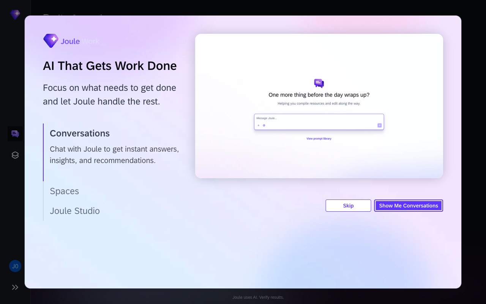
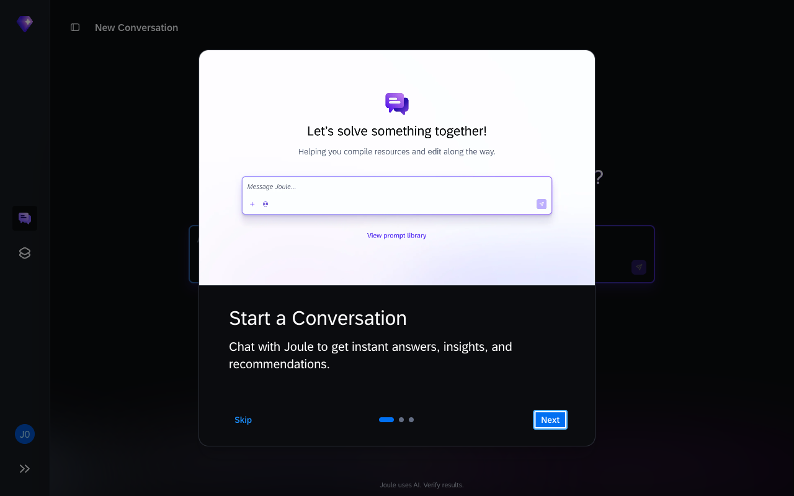
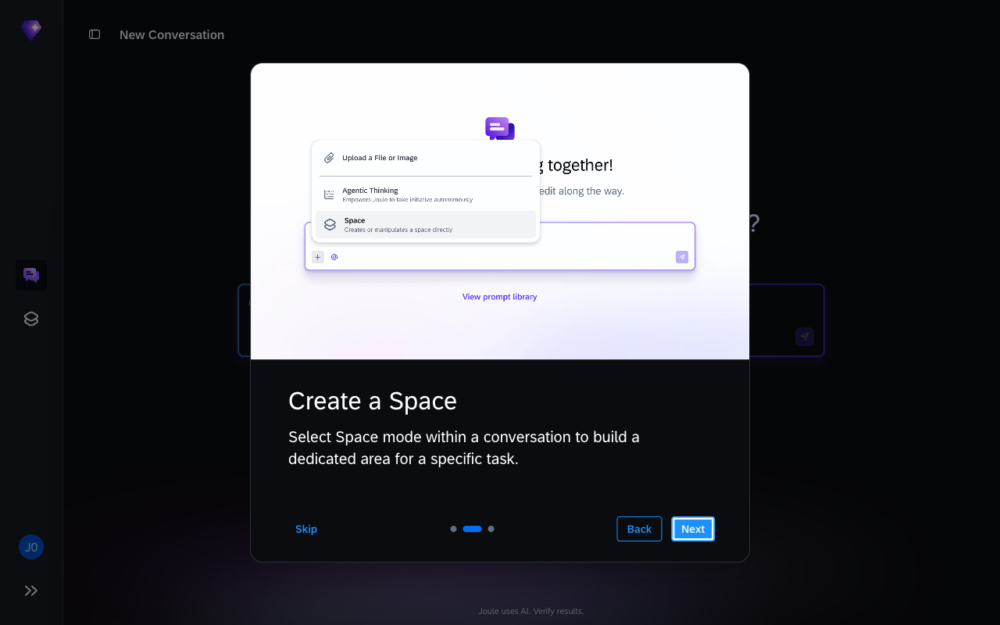
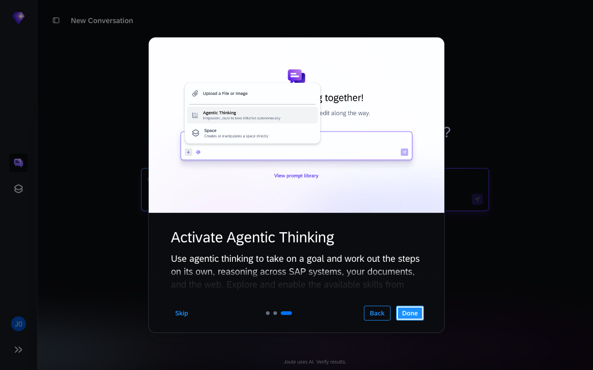
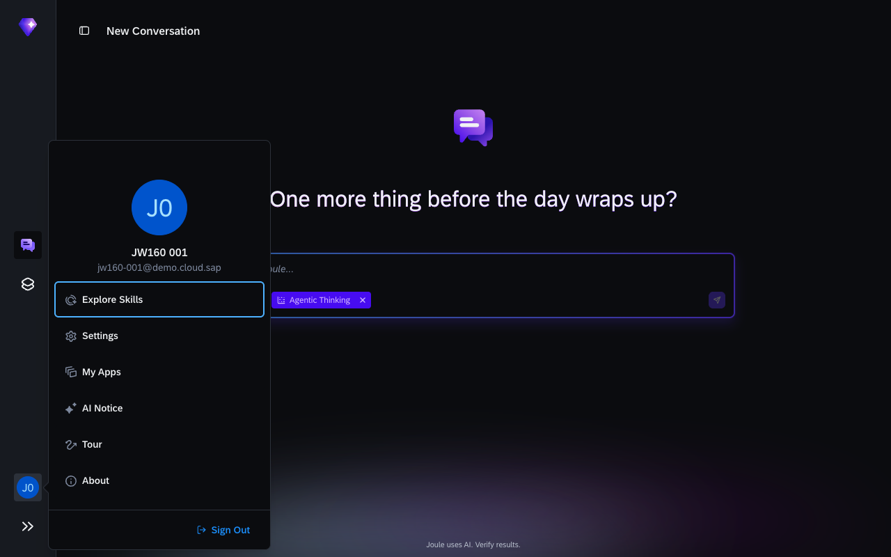
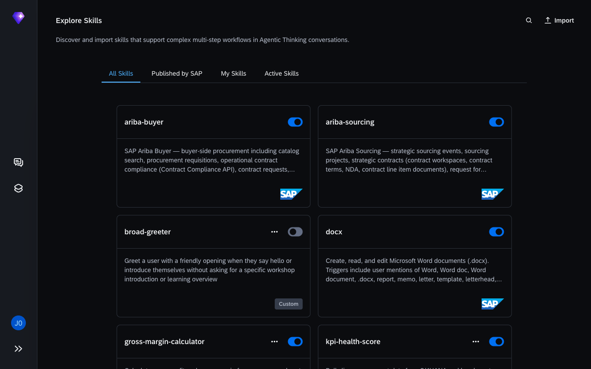
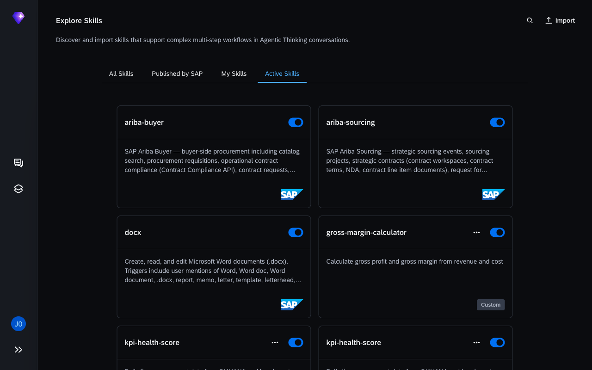
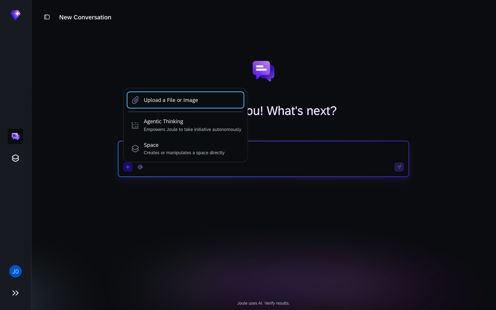
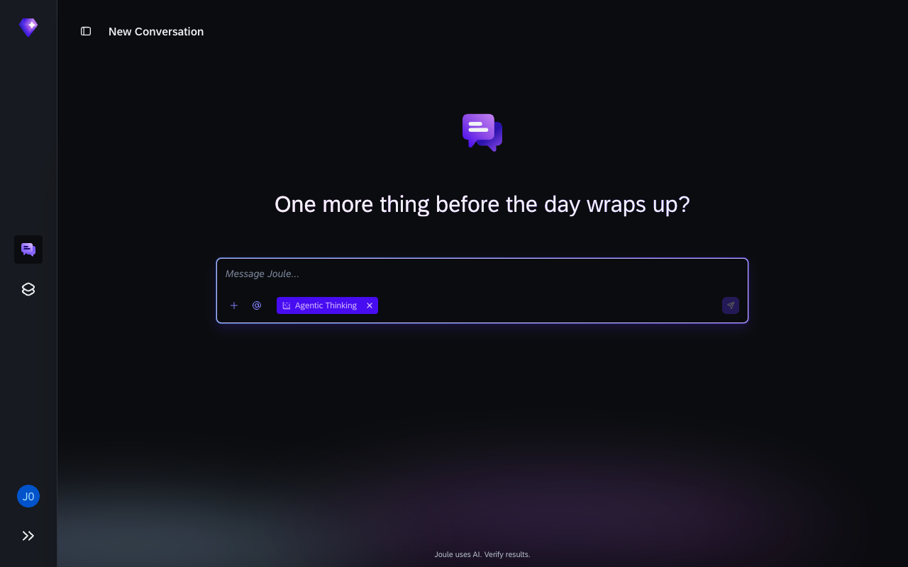

# Getting started

> [!NOTE]
> Screenshots were taken on a shared demo environment. The exact values, names, and counts in your session will differ — that is expected.

Before the main exercises begin, make sure Joule is open and connected to all SAP systems.

## What you'll need

- A browser (Chrome or Edge recommended)
- Your personal login credentials for this session (pre-configured on your machine)

## Open Joule

Navigate directly to the **Joule Work Standalone** application:

**[https://747238487.eu10.sapdas.cloud.sap/new/conversations](https://747238487.eu10.sapdas.cloud.sap/new/conversations)**

Log in with the credentials already set up on your machine. Each participant has their own dedicated user account.

## Take the product tour

When you open Joule Work for the first time, a guided tour starts automatically. Click **"Show Me Conversations"** to start it.



The tour walks you through three steps:

| Step | What it shows |
|---|---|
| 1: Start a Conversation | The main chat input and how to send a message |
| 2: Create a Space | The **+** menu and the Space mode option |
| 3: Activate Agentic Thinking | The Agentic Thinking toggle in the **+** menu |







Click **Next** after each step, then **Done** on the last step.

If the tour did not start automatically, you can trigger it manually:

1. Click your **account avatar** at the **bottom of the left sidebar**.
2. Select **"Tour"** from the menu.



## Explore Skills

Skills give Joule its abilities. Each skill connects to a specific SAP system or document type. Before starting the exercises, make sure the skills you need are active.

1. Click your **account avatar** at the bottom of the left sidebar.
2. Select **"Explore Skills"** from the menu.

The Explore Skills page lists all available skills as cards. A blue toggle means the skill is active; a gray toggle means it is off.



### Enable the required skills

Make sure the following skills are turned **on** (blue toggle). Click any gray toggle to activate it.

| Skill card | What it covers |
|---|---|
| `SAP S/4HANA Cloud Public Edition` | SAP S/4HANA Cloud Public Edition: ERP data |
| `SAP SuccessFactors HCM` | SAP SuccessFactors HCM: employees, org structure |
| `SAP SuccessFactors Learning` | SAP SuccessFactors Learning: courses, completions |
| `SAP Ariba Buying` | SAP Ariba Buying: purchase orders, invoices |
| `SAP Ariba Sourcing` | SAP Ariba Sourcing: RFPs, contracts, suppliers |
| `PDF` | PDF: read and query uploaded PDFs |
| `Word Documents` | Word Documents: read and query uploaded Word files |

When all required skills are on, the page should look like this:



Close the tab or click **Conversations** in the left sidebar to return to Joule.

## Enable Agentic Thinking

Agentic Thinking lets Joule act on your behalf, querying live systems, reasoning across steps, and taking action without requiring you to break the task into pieces. **All exercises in this workshop require Agentic Thinking to be active.** Without it, Joule routes prompts through documentation search instead of your connected SAP systems.

**Important:** The Agentic Thinking option only appears in a **new, empty conversation**. If you are in a conversation that already has messages, start a new one first.

To enable it:

1. Make sure you are in a **new conversation** (click **New** in the left sidebar if needed).
2. In the message input at the bottom, click the **+** (Select Mode) button.

    

3. Select **Agentic Thinking**.

    The input bar now shows an **Agentic Thinking** chip. Joule is ready.

    

> [!NOTE]
> The chip stays active for the entire conversation. You only need to set it once per conversation.

## Confirm your connected systems

Back in the main conversation, type:

```
What SAP systems do you have access to?
```

Joule lists the SAP systems it is connected to. Confirm that S/4HANA and SuccessFactors appear. If any expected system is missing, let your instructor know before continuing.

## Your environment

Each participant machine comes pre-configured with its own user account. No shared credentials are needed. Log in with the account on your machine.

## Summary

Continue to [Exercise 1 - Say Hello to Joule](../ex1/README.md).
