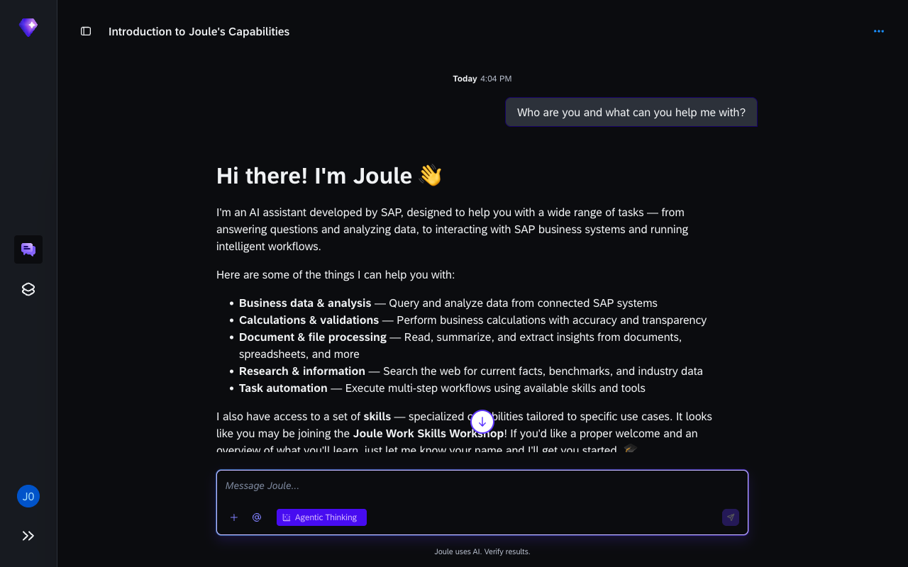
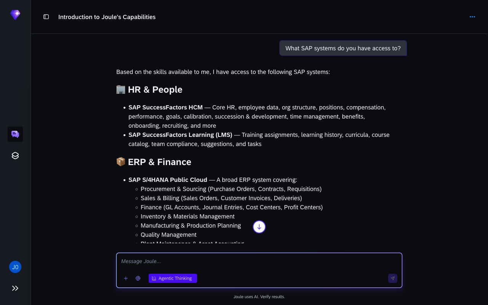
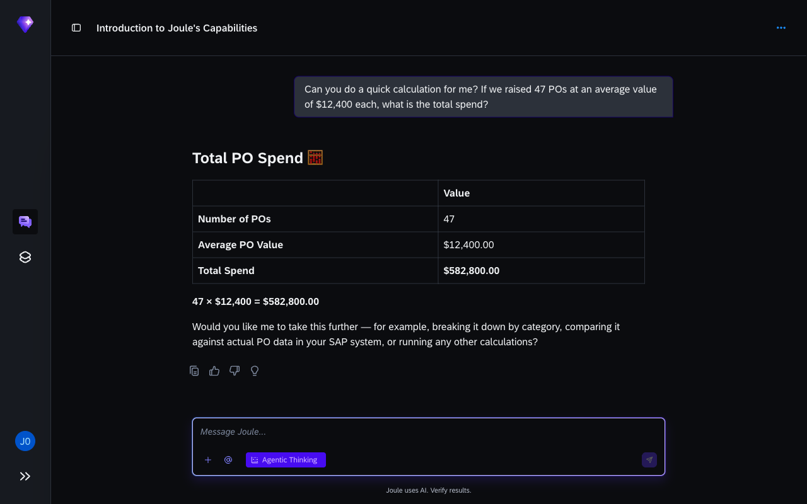

# Exercise 1 - Say hello to Joule

**Duration:** ~8 min | **Level:** Beginner

> [!TIP]
> **Goal:** You've seen what Joule knows, what it admits it can't do, and how to read its responses — without any SAP-specific knowledge.
>
> If you want to try it yourself first, open a new Joule conversation and see how far you get. The step-by-step guide below is there when you need it.

> [!NOTE]
> Screenshots were taken on a shared demo environment. The exact values, names, and counts in your session will differ — that is expected.

> [!IMPORTANT]
> Make sure **Agentic Thinking** is enabled before you start. See [Exercise 0: Enable Agentic Thinking](../ex0/README.md#enable-agentic-thinking) if you haven't done this yet. Without it, Joule will route prompts through documentation search instead of your live SAP systems.

Before touching any SAP data, spend a few minutes talking to Joule about itself. The goal is to get a feel for how it communicates, what it can and can't do, and how it handles follow-up questions. No SAP knowledge needed.

## Exercise 1.1 - Ask Joule to introduce itself

Try these prompts one at a time and read each response before moving on.

1. Type this in the Joule chat panel:
    ```
    Who are you and what can you help me with?
    ```
    Joule introduces itself and summarises what it can do.

    

2. Ask about the connected systems:
    ```
    What SAP systems do you have access to?
    ```
    Joule confirms the SAP systems it is connected to, including what data it can access from each one.

    

3. Test how Joule explains a business concept:
    ```
    Can you explain what a purchase order is in simple terms?
    ```

## Exercise 1.2 - Explore limitations and data freshness

Knowing what Joule *can't* do is just as useful as knowing what it can.

1. Ask about its limitations:
    ```
    What are your limitations? What can't you do?
    ```

2. Ask about data freshness:
    ```
    How current is the data you show me? When was it last refreshed?
    ```
    Joule queries your SAP systems live. There is no nightly batch or data copy.

3. Test a quick calculation:
    ```
    Can you do a quick calculation for me? If we raised 47 POs at an average value of $12,400 each, what is the total spend?
    ```
    Joule calculates the result directly.

    

## What to look for

- Joule answers in plain English, no transaction codes or menus.
- It's straight about what it can't do.
- Follow-up questions work naturally. After any answer, try *"Can you give me an example?"* or *"What else can I do?"*

## Reflection

Before moving on:
- Did Joule understand all your questions without any SAP-specific phrasing?
- Were you surprised by any of its stated limitations?
- What do you think will be the most useful thing Joule can do for your day-to-day work?

## Summary

You've had your first Joule conversation and confirmed it handles plain-English questions, explains its limits clearly, and queries live data. Continue to [Exercise 2 - Query Live S/4HANA Data](../ex2/README.md).
