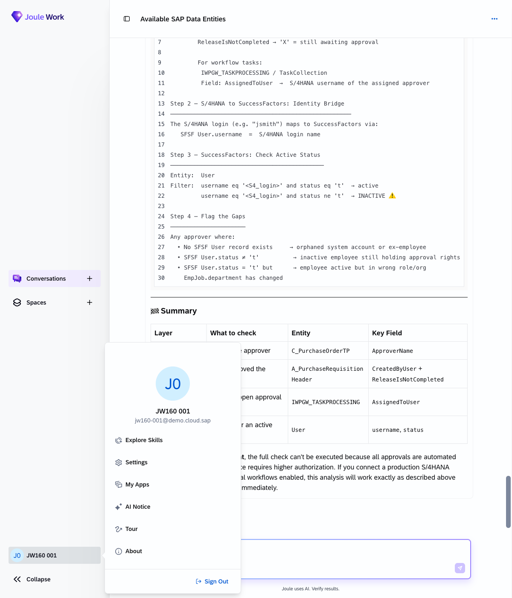
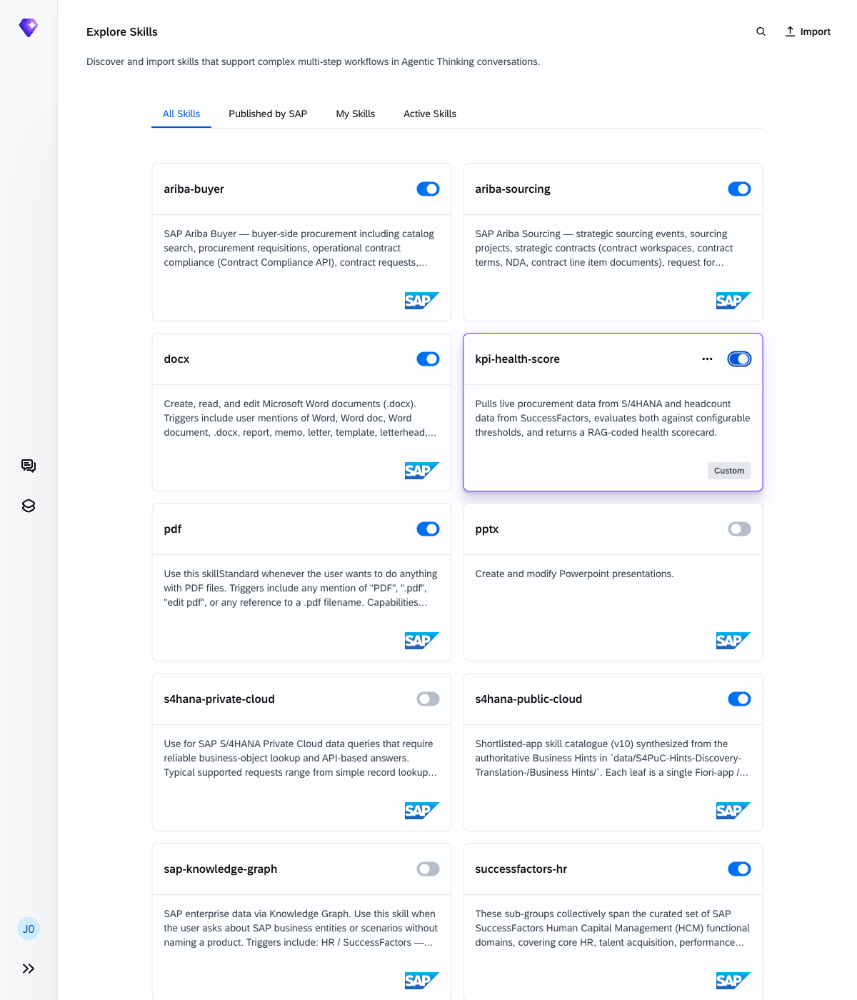
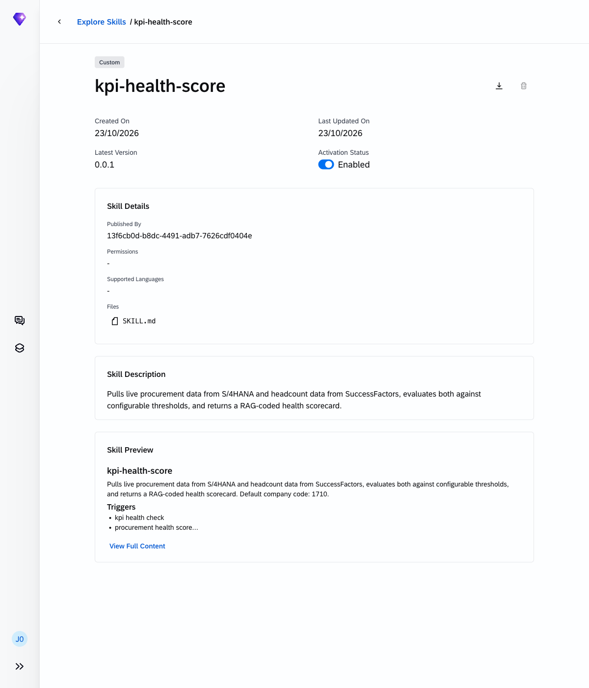
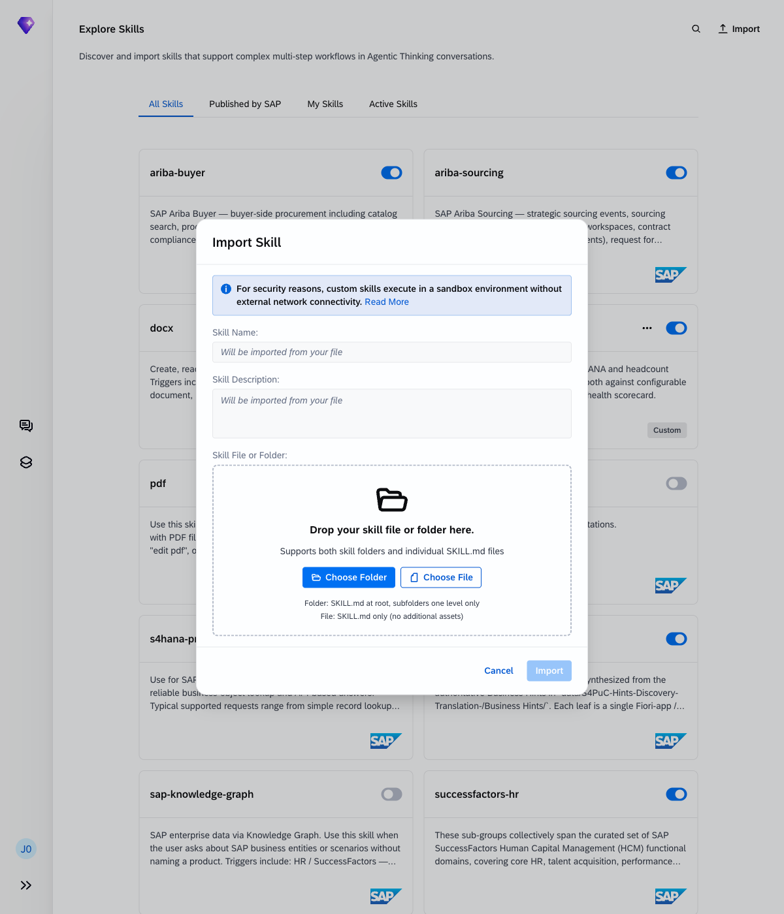
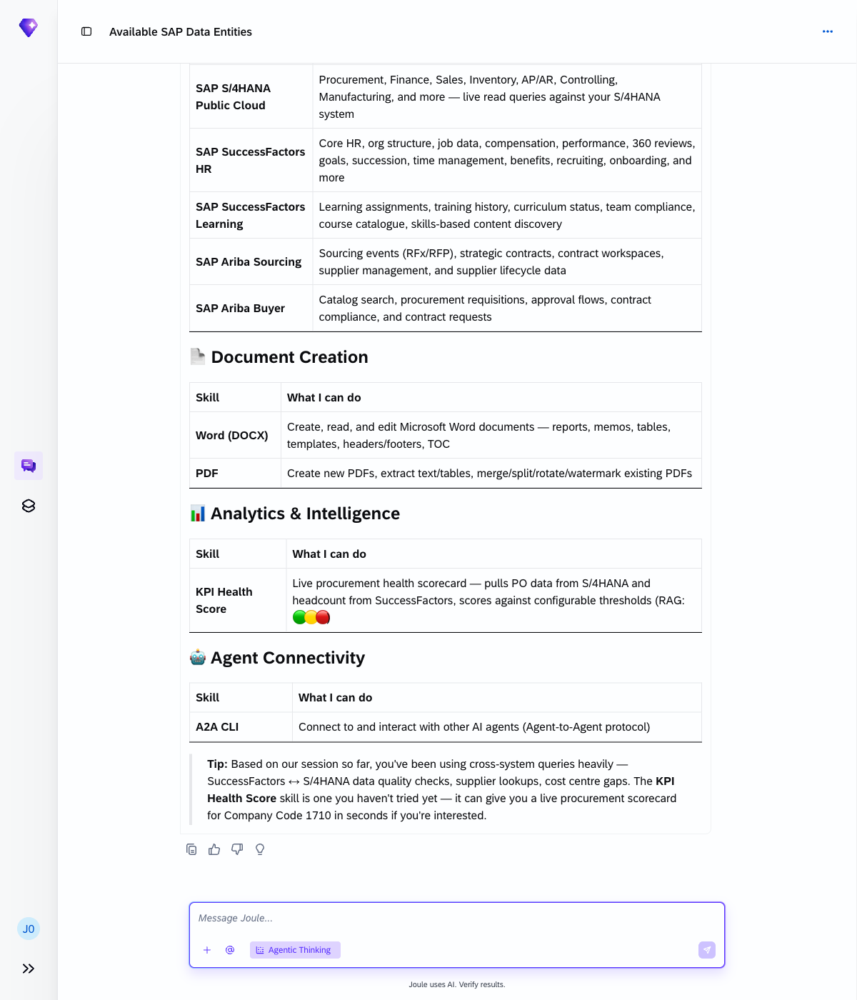
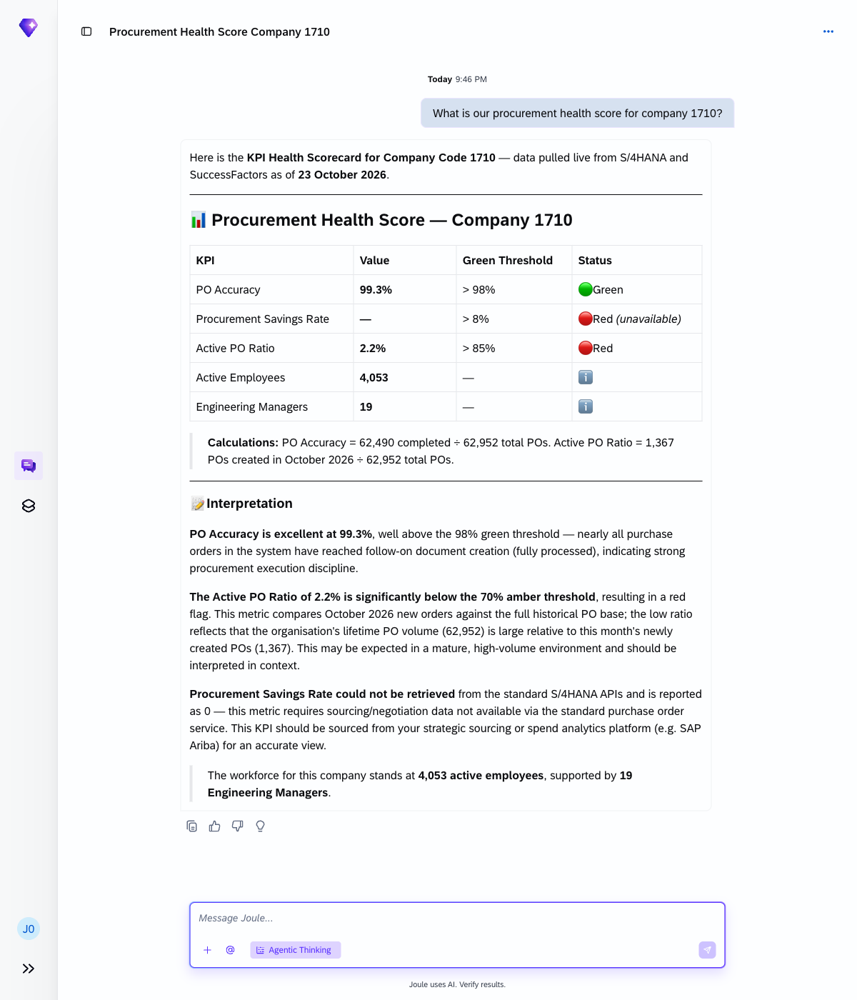

# Exercise 10 - Upload, activate and test a new skill

**Duration:** ~30 min | **Level:** Expert

> **Note:** Screenshots were taken on a shared demo environment. The exact values, names, and counts in your session will differ — that is expected.

Skills are pre-built capability packs that extend what Joule can do. They connect Joule to additional systems, APIs, and domain knowledge beyond its built-in set. In this final exercise you'll upload a skill, activate it, and test it at the depth that fits your background.

## Background: what is a skill?

A skill is a configuration file that tells Joule which APIs to call, what data entities are available, how to interpret questions in a specific domain, and how to format results. Think of it as a plug-in: once activated, Joule gains new expertise without any redeployment.

Skill files are `SKILL.md` documents: markdown files with a YAML frontmatter block at the top that provides the skill's `name` and `description`, followed by the skill body with triggers and instructions for Joule. You can import either a single `SKILL.md` file or a folder with `SKILL.md` at the root (with subfolders one level deep for assets).

```markdown
---
name: my-skill
description: "What this skill does."
---

# my-skill
...
```

Skill packages are typically provided by:

- Your SAP system administrator or Centre of Excellence
- The SAP Joule Skill Catalogue (accessible via your user profile → **Explore Skills**)
- A custom skill built by your internal IT team

## How to reach the Skill Explorer

Click your user avatar in the bottom-left corner of Joule, then select **Explore Skills** from the menu.



The Explore Skills page shows all skills installed in your Joule tenant. The page has four tabs: **All Skills**, **Published by SAP**, **My Skills**, and **Active Skills**. Skills published by SAP appear under Published by SAP. Your own imported skills appear under My Skills. Use the toggle on each card to enable or disable a skill.



Click any skill card to read its full description and understand what questions it handles.



## How to import a new skill

Click **Import** in the top-right corner of the Explore Skills page.

The **Import Skill** dialog opens. Drag your `SKILL.md` file onto the drop zone, or click **Choose File** to select it from your filesystem. The skill name and description are pre-filled from the file's YAML frontmatter.

> **Security note:** Custom skills execute in a sandbox environment without external network connectivity.



Click **Import** to install. The skill appears in your skill list under All Skills. **Important:** the skill toggle is set to off after import. Click the toggle to enable the skill before using it.

## Choose your track

This exercise runs at three levels. Work through the track that fits your background.

---

### Track A: Business User (~20 min)

Audience: finance managers, HR leads, operations, no prior coding background required.

Your instructor has provided a pre-built **KPI Health Score** skill as a `SKILL.md` file. This skill pulls live data from S/4HANA and SuccessFactors, evaluates it against configurable thresholds, and returns a colour-coded RAG (Red/Amber/Green) health score.

Step 1: Upload the skill

1. Click your user avatar → **Explore Skills**
2. Click **Import**
3. Choose the `kpi-health-score/SKILL.md` file from the `exercises/ex10/kpi-health-score/` folder (or as provided by your instructor)
4. Click **Import** to install it
5. Find the **kpi-health-score** card in the All Skills list and click its toggle to **Enable** it

Step 2: Verify the skill is active

```
What skills do you currently have available?
```

The KPI Health Score skill should appear in the list.



Step 3: Test the skill

```
What is our procurement health score for company 1710?
```

Joule returns a RAG-coded scorecard with live data from S/4HANA and SuccessFactors compared against the configured thresholds. Expected results for this tenant:

| KPI | Value | Status |
|-----|-------|--------|
| PO Accuracy | ~99% | 🟢 Green |
| Procurement Savings Rate | — | 🔴 Red (unavailable via standard PO API) |
| Active PO Ratio | ~2% | 🔴 Red (monthly new POs vs. cumulative base) |
| Active Employees | ~4,000 | ℹ️ Info |
| Engineering Managers | ~19 | ℹ️ Info |

> **Note:** The Active PO Ratio appears Red because the threshold (85%) is calibrated for a short window (e.g. weekly new POs) but the metric is calculated against the tenant's full historical PO backlog. Joule's interpretation note explains this. Procurement Savings Rate is unavailable via the standard S/4HANA PO API and requires Ariba sourcing data.



Step 4: Adjust a threshold

Open `SKILL.md` in a text editor. Find the `po_accuracy` threshold and change the amber value from `0.98` to `0.96`. Save the file and re-import it via **Explore Skills**. Run the health check again: the PO Accuracy row should reflect your updated threshold.

---

### Track B: Power User / Analyst (~25 min)

Audience: business analysts, consultants, power users, comfortable editing config files.

Start from the skill template provided by your instructor and add a new KPI.

**Step 1: Open the `SKILL.md` template** and find the commented-out section at the bottom:

```markdown
<!-- Track B: add your own KPI here
- id: my_kpi
  label: My Custom KPI
  domain: Cross-System
  ...
-->
```

**Step 2: Define a new KPI.** Add an "Employees per Active PO" metric. It requires headcount from SuccessFactors and active PO count from S/4HANA. Ask your instructor for the OData entity names if you need them.

**Step 3: Upload and test** your extended skill. Then run a comparison:

```
Run a KPI check and show me the before and after for the new metric.
```

---

### Track C: Developer (~30 min)

Audience: BTP developers, SAP BTP architects, full technical background.

Build the KPI engine as a microservice and connect it to Joule via the A2A (Agent-to-Agent) protocol.

**Step 1: Scaffold the agent.** Use the `joule-a2a-agent` starter project. Implement the KPI engine as a TypeScript or Python microservice with its own tools for querying S/4HANA and SuccessFactors.

**Step 2: Deploy to BTP.** Deploy to BTP Cloud Foundry with service instances bound to both the S/4HANA and SuccessFactors APIs.

**Step 3: Register with Joule.** Register the agent via the A2A protocol and publish an Agent Card.

> **Note:** Your Joule instance must be on schema version >= 3.28.0 for A2A support. Run `joule status` to confirm before you start.

**Step 4: Test end-to-end.**

```
Run a KPI health check.
```

Joule routes the prompt to your external A2A agent. Confirm in your agent's logs that the call arrived.

---

## All tracks converge

At the end of the session, all three tracks demo using the same prompt:

```
Run a KPI health check for company 1710.
```

Track A's threshold change and Track C's A2A agent both respond, showing the same extensibility story at three different levels.

## Design your own workflow

Before you leave, take five minutes to think about a recurring task in your own role that involves data from multiple systems. Try to sketch it as 3 to 5 steps Joule could handle:

1. *(your step 1)*
2. *(your step 2)*
3. *(your step 3)*

Share it with the group.

## Summary

You've seen how skills work, explored the Skill Explorer, and installed a new skill to extend Joule's capabilities with live SAP data. All 10 exercises are done.

---

## Continue the journey

Want to go deeper on skill creation? The follow-on hands-on session picks up exactly where Track A and B leave off. You'll build a skill from scratch, connect it to a live SAP system, and publish it to your tenant.

**JW260 — Build your first skill in Joule: A developer's guide to skill creation**

| Date | Time |
|------|------|
| October 28, 2026 | 10:30 AM CET |
| October 29, 2026 | 11:30 AM CET |

---

*If you have questions about the skill design patterns covered in this exercise, the full assessment document (`Joule_Skill_Workshop_Assessment.docx`) is available from your instructor.*
