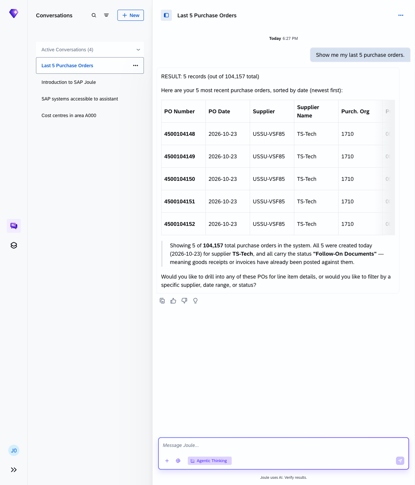
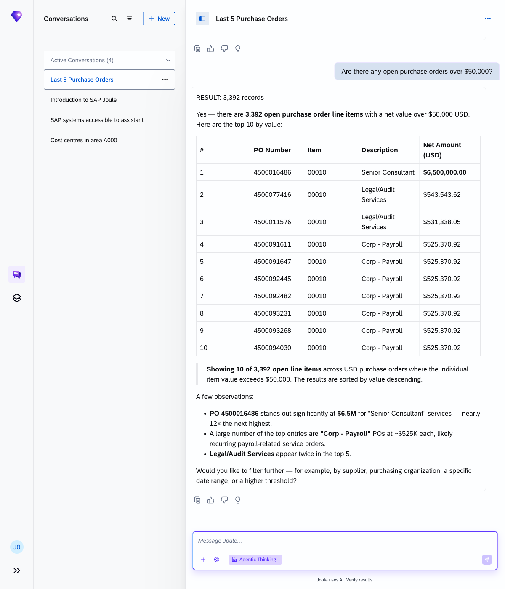
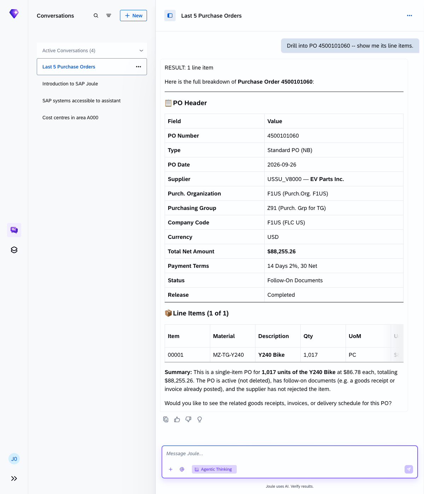
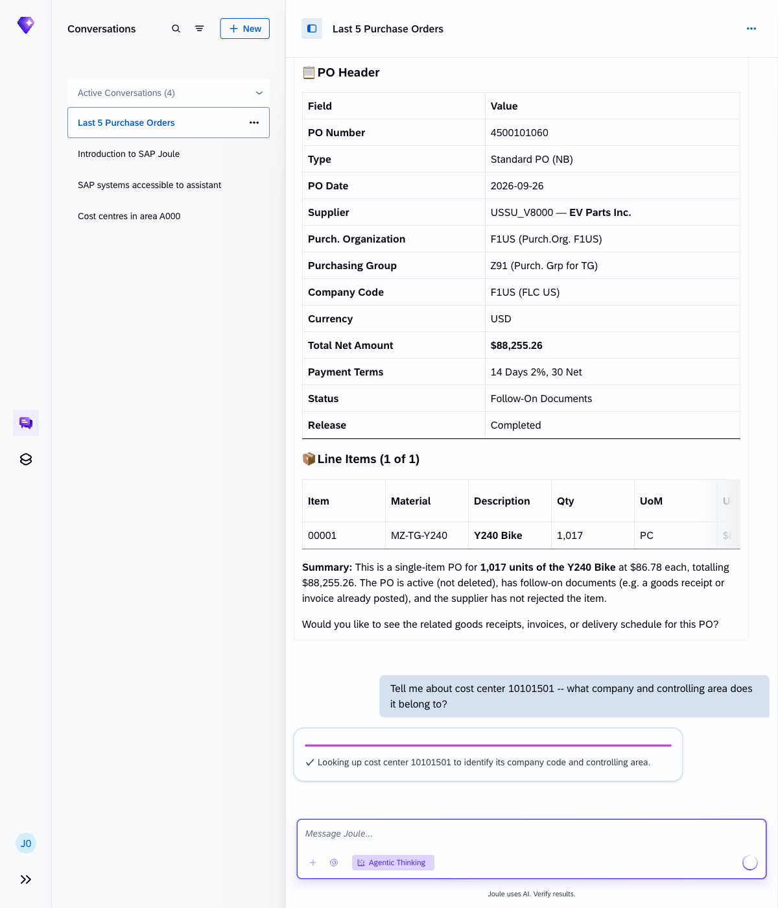
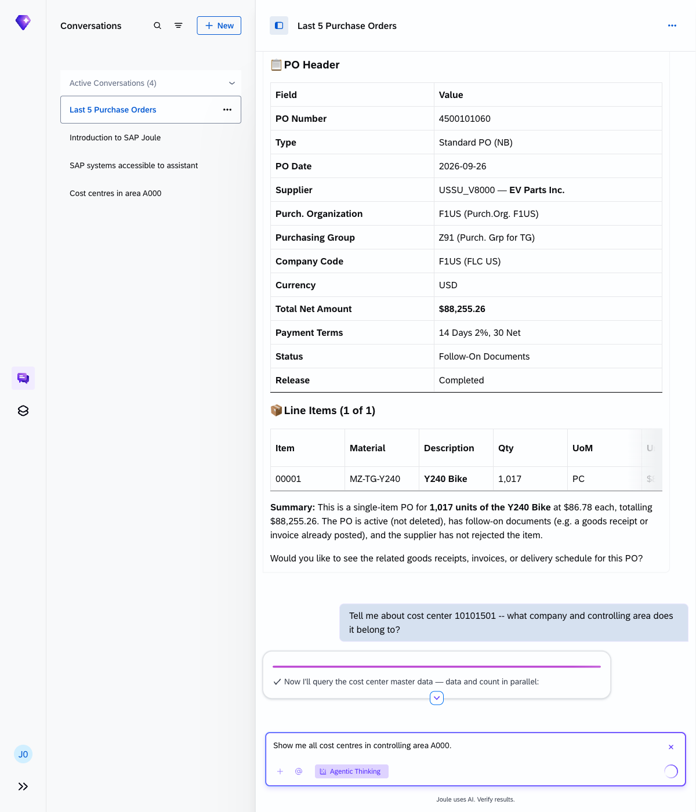
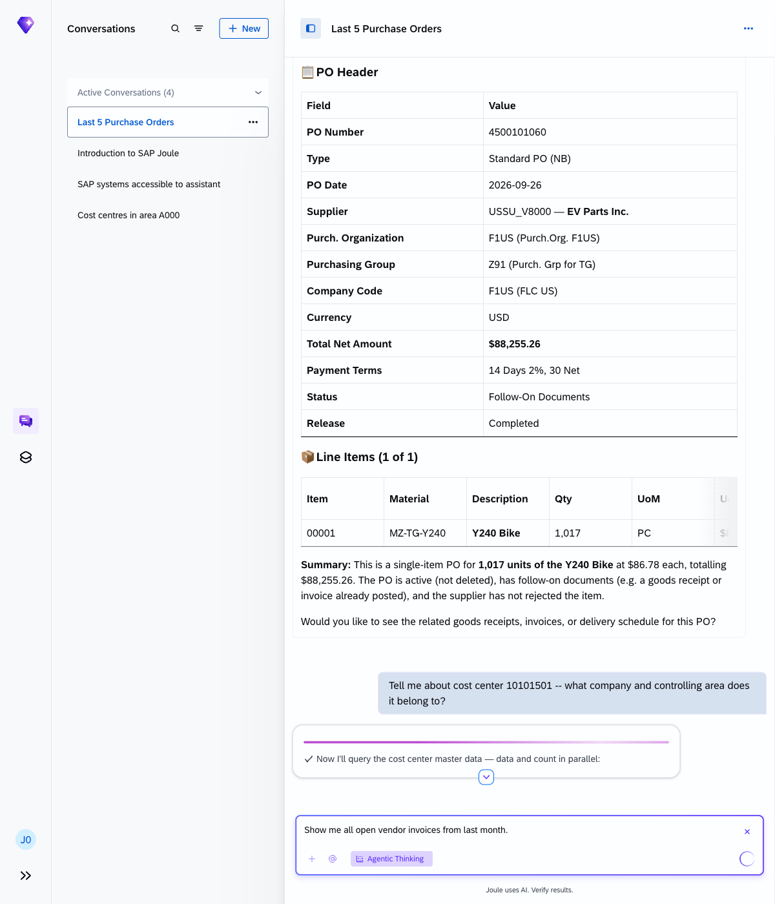
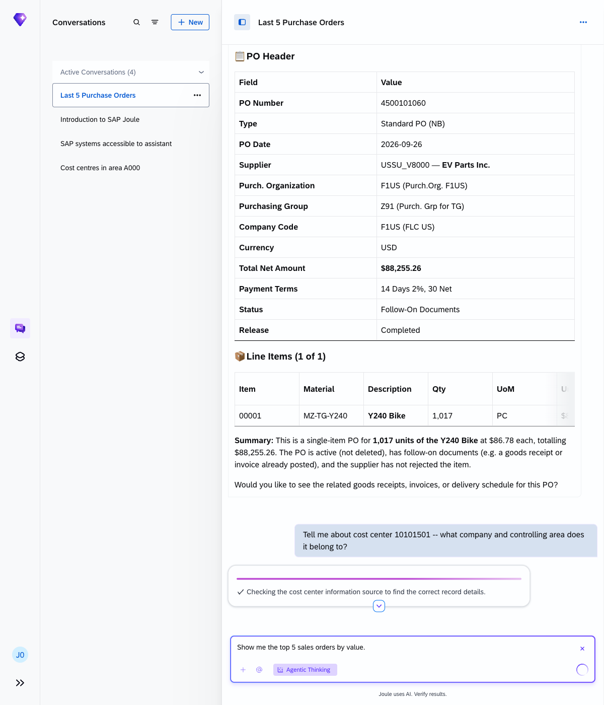
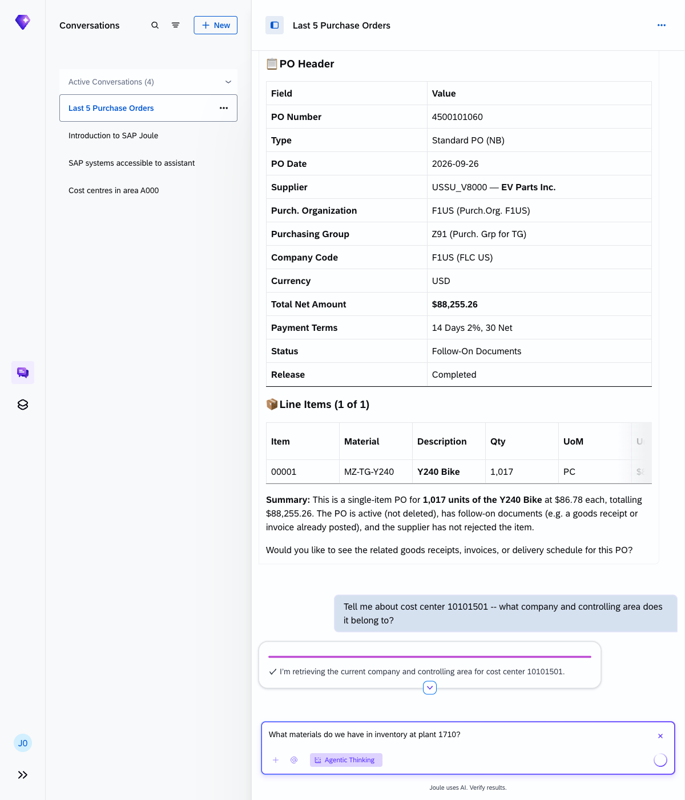
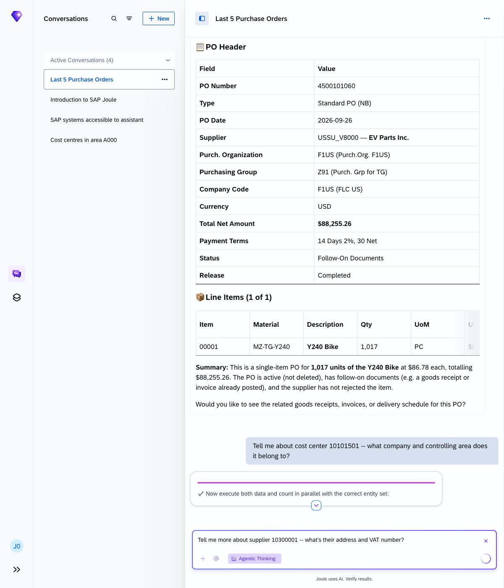

# Exercise 2 - Query live S/4HANA data

**Duration:** ~18 min | **Level:** Easy

> **Note:** Screenshots were taken on a shared demo environment. The exact values, names, and counts in your session will differ — that is expected.

In this exercise you'll ask Joule to pull data from a real SAP S/4HANA Public Cloud system across several business areas: purchasing, finance, sales, materials, and suppliers. Watch how Joule picks the right Fiori app or OData service for each question without you having to name one.

## Exercise 2.1 - Purchase orders

1. Retrieve your most recent purchase orders:
    ```
    Show me my last 5 purchase orders.
    ```
    Joule returns a table showing PO number, date, type, supplier, material, plant, company code, and status, all sourced live from S/4HANA.

    

2. Filter by value:
    ```
    Are there any open purchase orders over $50,000?
    ```
    Joule searches across your open POs and summarises how many exceed the threshold, the highest value, and the top suppliers involved.

    

3. Drill into a specific PO:
    ```
    Drill into PO 4500101060 -- show me its line items.
    ```
    Joule shows the PO header (type, date, supplier, total amount) and a line-item table (item number, description, material, quantity, unit, unit price, net total, plant), all without switching apps.

    

## Exercise 2.2 - Cost centres

1. Look up a specific cost centre:
    ```
    Tell me about cost center 10101501 -- what company and controlling area does it belong to?
    ```
    Joule retrieves the master data for this cost centre: it's the R&D (DE) cost centre under company code 1010 (Germany), controlling area A000, profit centre YB600, in EUR.

    

2. List all cost centres in a controlling area:
    ```
    Show me all cost centres in controlling area A000.
    ```
    Joule returns all 568 cost centres in area A000, grouped by company code (1010 Germany, 1110 UK, 1710 US, and more) and by category (Administration, Production, Management, and others).

    

## Exercise 2.3 - Finance, sales, and materials

Try each of these in turn:

1. Open vendor invoices:
    ```
    Show me all open vendor invoices from last month.
    ```
    Joule searches across all company codes and finds the open invoices. The response includes a supplier summary (e.g. DE Supplier 2 is the largest creditor in Germany with €14.4M across 18 invoices) and the top individual invoices sorted by amount.

    > **Note:** The system holds hundreds of thousands of open invoice lines across multiple company codes. Joule retrieves the first batch and summarises them; the full dataset is visible in the Manage Supplier Invoices Fiori app.

    

2. Top sales orders:
    ```
    Show me the top 5 sales orders by value.
    ```
    Joule ranks the top 5 across all 198,002 orders in the system. The highest-value order is $2.5M (SK Vision Corp); all five come from Sales Organisation 1710 (US) and total $10.76M combined.

    

3. Inventory check:
    ```
    What materials do we have in inventory at plant 1710?
    ```
    Joule identifies 104 distinct materials at Plant 1710 (US) by searching procurement records: mountain, racing, cruise, electric, and exercise bike components across storage locations 171A and 171C.

    > **Note:** Real-time stock quantities require Inventory Management authorisation (Fiori app F1682). Without it, Joule falls back to PO history, which still gives you the full materials list.

    

Each question pulls from a different Fiori app and OData service. Joule routes them automatically.

## Exercise 2.4 - Supplier deep-dive

Look up a specific supplier's master record:

```
Tell me more about supplier 10300001 -- what's their address and VAT number?
```

Joule returns the full supplier profile from the Business Partner service: name (Inlandslieferant DE 1, a German domestic supplier), address (Hullerner Straße 23, Haltern am See, North Rhine-Westphalia), and tax details including the VAT registration number DE178562898.



## Key takeaways

| What you observed | What it means |
|---|---|
| Results appeared without a transaction code | Joule maps your question to the right OData API automatically |
| You could drill into a PO with a follow-up question | Conversation context carries across turns |
| Different topics (POs, invoices, materials) all worked | Joule routes each question to the correct backend service |

## Summary

You've retrieved live data from SAP S/4HANA across five business areas, all through natural language. Continue to [Exercise 3 - Explore HR Data in SuccessFactors](../ex3/README.md).
