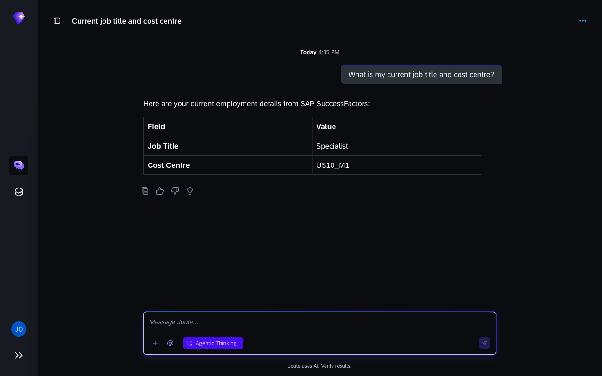
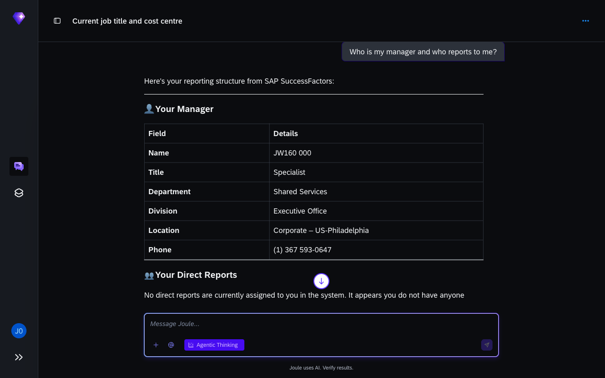
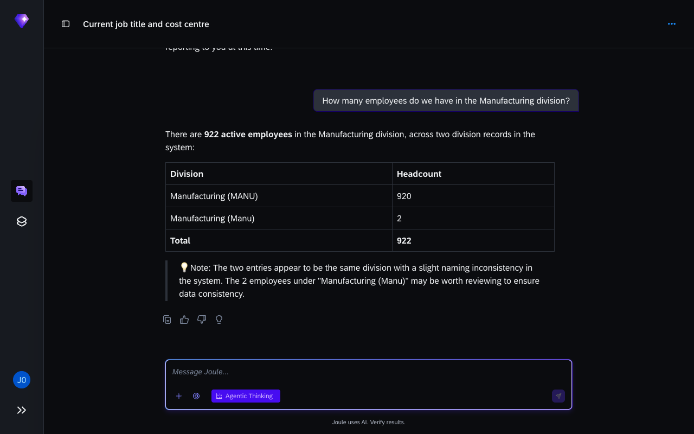
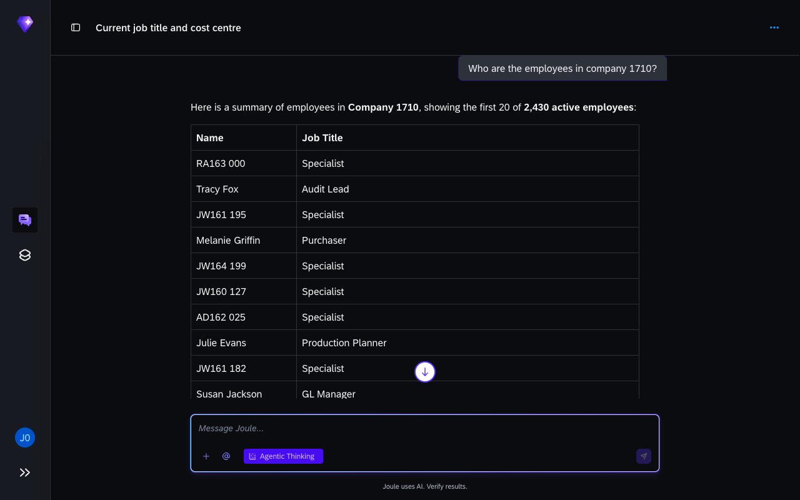
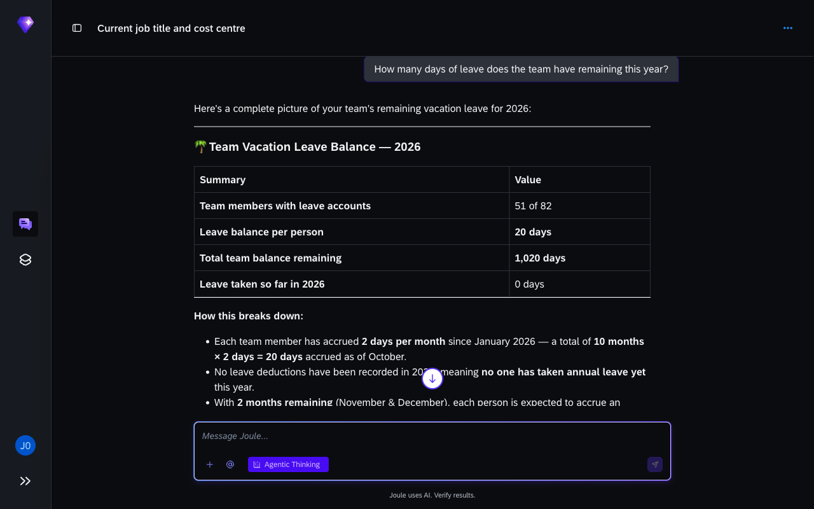

# Exercise 3 - Explore HR data in SuccessFactors

**Duration:** ~18 min | **Level:** Easy

> [!TIP]
> **Goal:** You've pulled HR data across headcount, performance reviews, time off, and recruiting from a live SuccessFactors system.
>
> If you want to try it yourself first, open a new Joule conversation and see how far you get. The step-by-step guide below is there when you need it.

> [!NOTE]
> Screenshots were taken on a shared demo environment. The exact values, names, and counts in your session will differ — that is expected.

> [!IMPORTANT]
> Make sure **Agentic Thinking** is enabled before you start. See [Exercise 0: Enable Agentic Thinking](../ex0/README.md#enable-agentic-thinking) if you haven't done this yet.

SAP SuccessFactors covers employee records, org structure, headcount, performance, goals, leave, and recruiting. In this exercise you'll ask Joule to retrieve all of it through conversation, without opening the SuccessFactors interface.

## Exercise 3.1 - Your profile

Start with yourself.

1. Find out your job title and cost centre:
    ```
    What is my current job title and cost centre?
    ```
    Joule identifies your user account automatically and returns your profile from SuccessFactors, including your job title and assigned cost centre.

    

2. Check your reporting line:
    ```
    Who is my manager and who reports to me?
    ```
    Joule shows your manager and any direct reports from SuccessFactors.

    

## Exercise 3.2 - Headcount

1. Count employees in a division:
    ```
    How many employees do we have in the Manufacturing division?
    ```
    Joule searches the org structure and returns the number of active employees in the Manufacturing division.

    

2. Get a headcount breakdown by division:
    ```
    Who are the employees in company 1710?
    ```
    Company 1710 has a large active headcount. Because listing every employee individually would be unwieldy, Joule returns a summary and offers to filter further by division, department, or job title.

    

## Exercise 3.3 - Performance and goals

1. Check active performance reviews:
    ```
    Show me the active performance reviews in my organisation.
    ```
    Joule queries the SuccessFactors Performance module and returns the current status of active review cycles.

2. Look at your own goals:
    ```
    What are my current performance goals?
    ```
    Joule queries the SuccessFactors Goals module and returns your active goal plans for the current review cycle.

## Exercise 3.4 - Time and absence

Ask about your team's remaining leave:

```
How many days of leave does the team have remaining this year?
```

Joule retrieves leave balances for the team and returns a summary: team size, leave type, balance per employee, and total remaining days.

> [!NOTE]
> The leave data reflects the primary vacation leave account. Other leave types such as sick leave and time in lieu are tracked separately in the system.



## Exercise 3.5 - Recruiting

Check for open job requisitions:

```
Are there any open job requisitions in my department?
```

Joule queries the SuccessFactors Recruiting module and returns the open requisitions visible for your department.

## Key takeaways

| What you observed | What it means |
|---|---|
| Profile and org data returned immediately | SAP SuccessFactors HCM data is live, with no data copy or cache |
| Headcount and leave data aggregated in one query | Joule can aggregate team data across large headcounts in a single query |
| Performance and goals accessible through conversation | No need to navigate SuccessFactors menus to retrieve structured HR data |

## Summary

You've used Joule to pull employee profiles, org headcount, performance reviews, leave balances, and recruiting data from SuccessFactors through conversation. Continue to [Exercise 4 - Cross-System Queries](../ex4/README.md).
