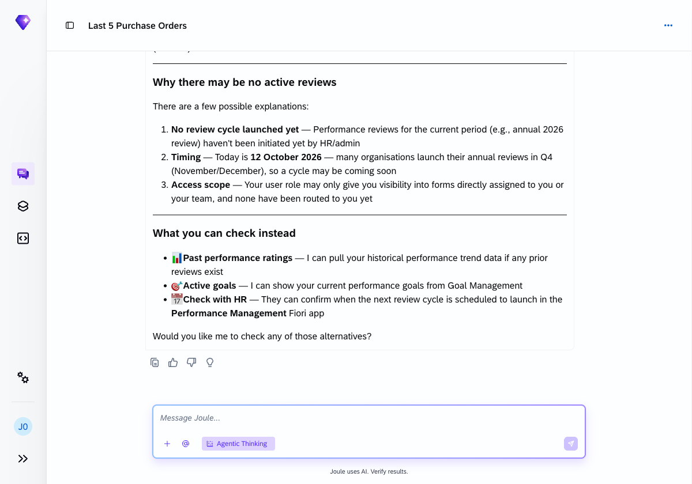
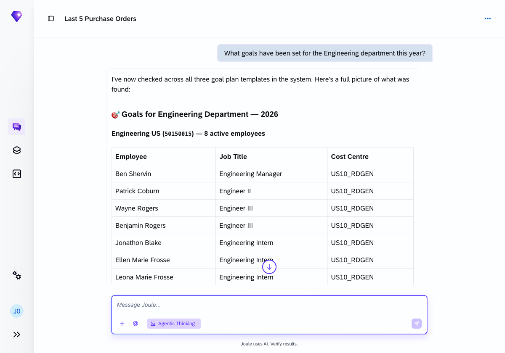
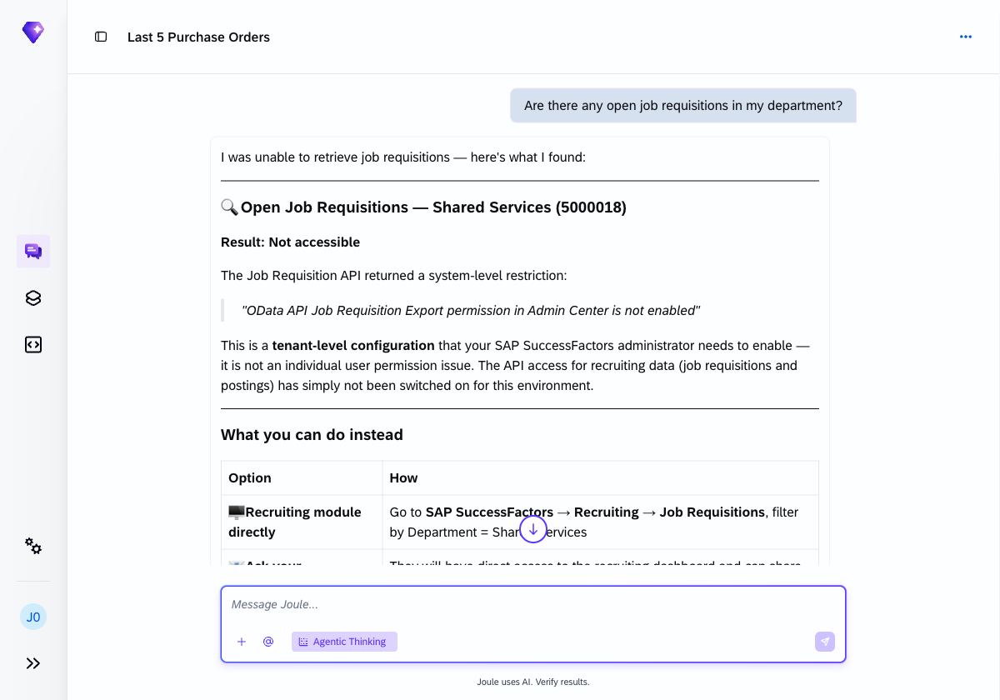

# Exercise 3 - Explore HR data in SuccessFactors

**Duration:** ~18 min | **Level:** Easy

> **Prerequisite:** Make sure **Agentic Thinking** is enabled before you start. See [Exercise 0: Enable Agentic Thinking](../ex0/README.md#enable-agentic-thinking) if you haven't done this yet.

SAP SuccessFactors covers employee records, org structure, headcount, performance, goals, leave, and recruiting. In this exercise you'll ask Joule to retrieve all of it through conversation, without opening the SuccessFactors interface.

## Exercise 3.1 - Your profile

Start with yourself.

1. Find out your job title and cost centre:
    ```
    What is my current job title and cost centre?
    ```
    Joule identifies the session user (JW160-000) automatically and returns your profile from SuccessFactors: job title **Specialist**, cost centre **US10_M1** (General Administration), department Shared Services (5000018), company 1710 (US), employed since 1 January 2021.

    

2. Check your reporting line:
    ```
    Who is my manager and who reports to me?
    ```
    Joule shows your manager (AD162-000, Shared Services, Philadelphia office) and confirms you have no direct reports in this demo environment; the reporting chain isn't fully populated.

    

## Exercise 3.2 - Headcount

1. Count employees in a division:
    ```
    How many employees do we have in the Manufacturing division?
    ```
    Joule searches the org structure and finds **5 employees** in the Manufacturing (MANU) division: Martín Lorenzo, Julia Díaz, Isabel Molina, Jorge Soler, and Mateo Crespo, all at location 2300-0001.

    

2. Get a headcount breakdown by division:
    ```
    Who are the employees in company 1710?
    ```
    Company 1710 has **2,224 active employees**. Because that's too many to list individually, Joule returns a headcount breakdown by division: EXEC (47%), CORP_SVCS (12%), MANU (9%), DIR_SALES (4%), and others.

    > **Note:** The response shows division-level headcount, not individual names. Retrieving the full employee list for 2,224 people can take several minutes; Joule summarises the data at division level for readability.

    

## Exercise 3.3 - Performance and goals

1. Check active performance reviews:
    ```
    Show me the active performance reviews in my organisation.
    ```
    Joule returns **0 active performance reviews**. This is expected in a demo environment; annual review cycles are typically launched in November or December, and no cycle has been started yet for 2026.

    

2. Look at team goals:
    ```
    What goals have been set for the Engineering department this year?
    ```
    Joule checks all three goal plan templates (Goal Plan Extended, My Goal Plan, 2025 Goal Plan) across the Engineering US department (50150015), which has 8 active employees. All templates return **0 goals**. Joule explains two reasons: role-based permissions limit visibility to your target population, and no goals have been entered for any employee in this demo environment.

    

## Exercise 3.4 - Time and absence

Ask about your team's remaining leave:

```
How many days of leave does the team have remaining this year?
```

Joule retrieves your leave accounts from SuccessFactors Time Off. In this demo environment, the 2026 Vacation and Sick Leave accrual accounts haven't been set up yet; they're configured to start on 1 January 2027. Only a Time Off in Lieu account is open (since January 2021) with no bookings. Because no direct reports are assigned, a team-level summary isn't available either.

> **Note:** This is a demo environment limitation. In a production system, Joule would show each team member's remaining entitlement, days taken, and balance at a glance.


## Exercise 3.5 - Recruiting

Check for open job requisitions:

```
Are there any open job requisitions in my department?
```

Joule attempts to query the Job Requisition API and returns a system-level restriction: *"OData API Job Requisition Export permission in Admin Center is not enabled."* This is a tenant configuration that hasn't been switched on in the demo environment. It's not an individual permission issue.

> **Note:** If this permission were enabled, Joule would list open requisitions for your department (Shared Services) with job title, status, and recruiter. You can still view them directly in **SAP SuccessFactors → Recruiting → Job Requisitions**.



## A note on permissions

When Joule says it can't show certain data (like goals for people outside your target population, or recruiting data requiring an admin configuration), that's the system working correctly. Joule respects Role-Based Permissions and tenant-level API settings. In a production deployment these would be configured to match your role.

## Key takeaways

| What you observed | What it means |
|---|---|
| Profile and org data returned immediately | SuccessFactors HR data is live, with no data copy or cache |
| Goal and review results were empty | Demo environment doesn't have active performance cycles or goals entered |
| Leave accounts not yet active for 2026 | Annual accrual cycles run at year-start; demo data reflects this |
| Job requisitions not accessible | Tenant-level OData API permission controls recruiting data access |

## Summary

You've used Joule to pull employee profiles, org headcount, performance reviews, leave balances, and recruiting data from SuccessFactors through conversation. Continue to [Exercise 4 - Cross-System Queries](../ex4/README.md).
