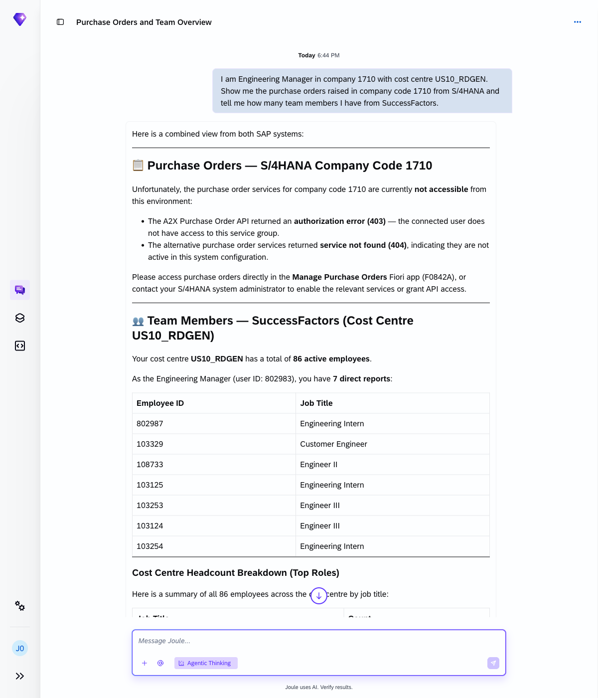
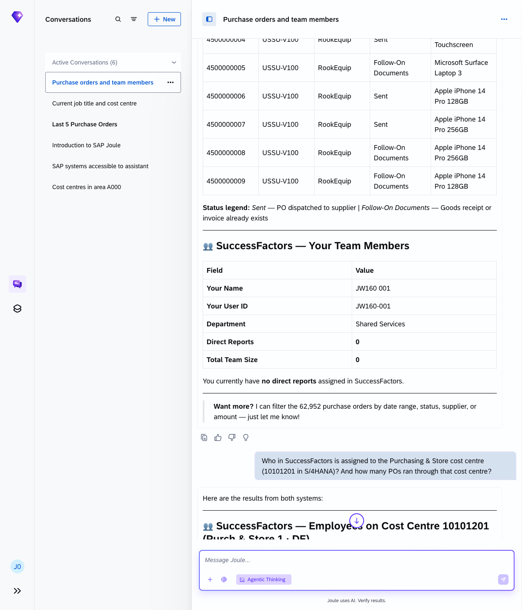
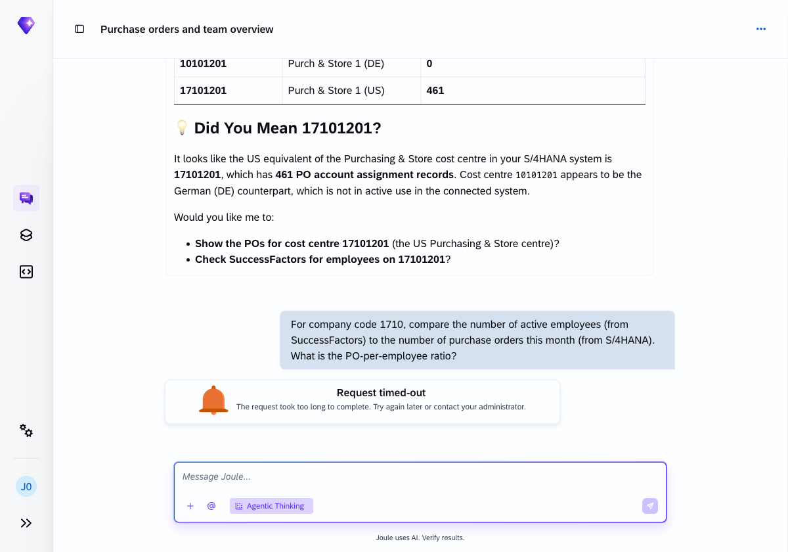
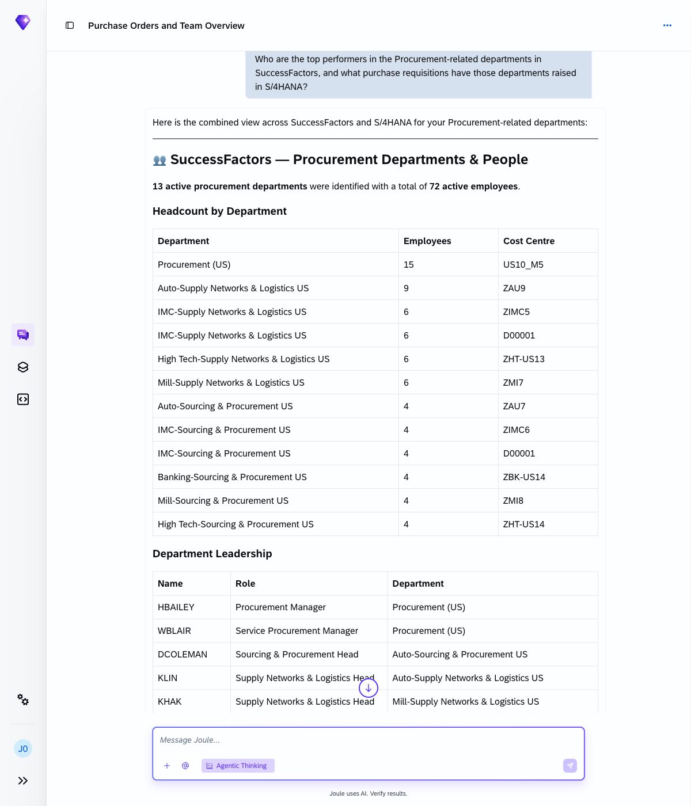
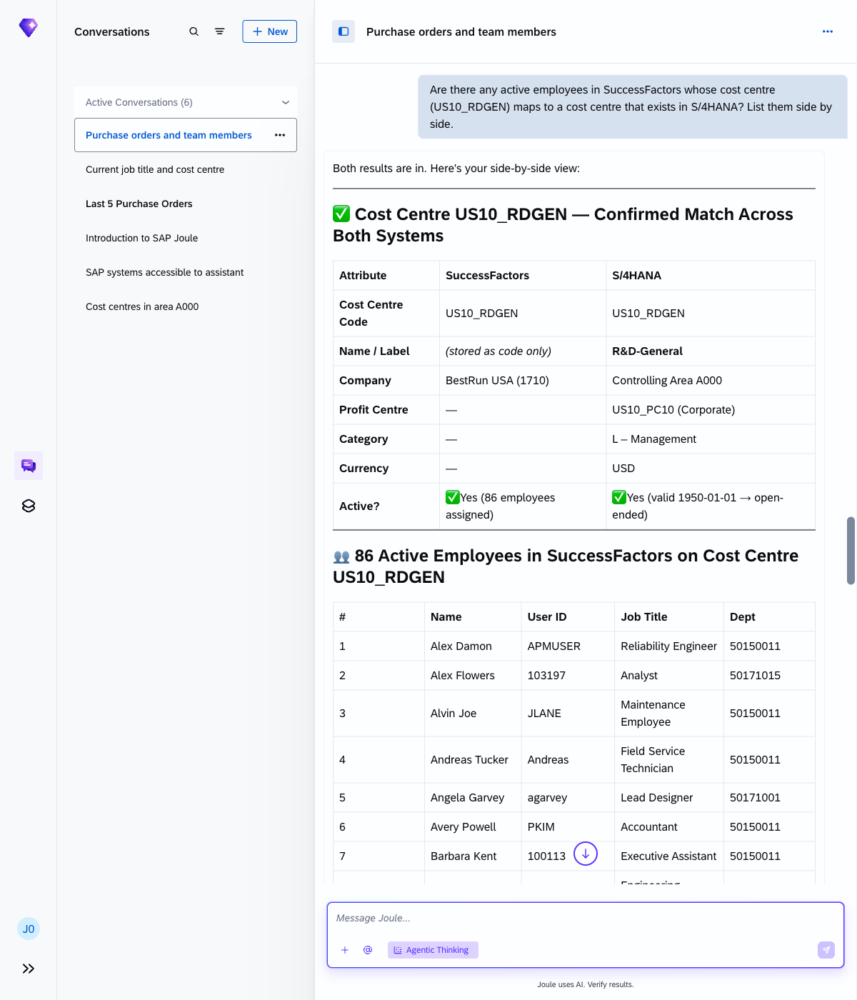

# Exercise 4 - Cross-system queries

**Duration:** ~25 min | **Level:** Intermediate

> **Note:** Screenshots were taken on a shared demo environment. The exact values, names, and counts in your session will differ — that is expected.

> **Prerequisite:** Make sure **Agentic Thinking** is enabled before you start. See [Exercise 0: Enable Agentic Thinking](../ex0/README.md#enable-agentic-thinking) if you haven't done this yet.

Joule can combine data from SAP S/4HANA and SuccessFactors in a single answer. This exercise runs five scenarios that cross the ERP/HR boundary.

The bridge between the two systems in this environment is **company code 1710**, which exists as a financial entity in S/4HANA and a company entity in SuccessFactors.

## Exercise 4.1 - Cost centre bridge

Link your HR identity to procurement activity:

```
I am Engineering Manager in company 1710 with cost centre US10_RDGEN. Show me the purchase orders raised in company code 1710 from S/4HANA and tell me how many team members I have from SuccessFactors.
```

Joule makes two API calls in parallel — one to S/4HANA for purchase orders, one to SuccessFactors for your team — then combines both into a single response showing PO data and headcount side by side.



## Exercise 4.2 - Manager to procurement responsibility

Resolve a cost centre across both systems:

```
Who in SuccessFactors is assigned to the Purchasing & Store cost centre (10101201 in S/4HANA)? And how many POs ran through that cost centre?
```

Joule checks both systems and returns the number of active employees assigned to that cost centre in SuccessFactors along with the purchase order count from S/4HANA. If the cost centre numbering differs between the two systems, Joule flags the discrepancy and surfaces the closest match.



## Exercise 4.3 - Headcount vs. spend ratio

Ask Joule to do cross-system arithmetic:

```
For company code 1710, compare the number of active employees (from SuccessFactors) to the number of purchase orders this month (from S/4HANA). What is the PO-per-employee ratio?
```

Joule queries both systems in parallel and calculates the ratio, providing a cross-system comparison table with active headcount, PO count for the month, and the resulting ratio.

> **Note:** The PO count reflects orders created up to the date of the query, not a full month. Joule flags this in its response.



## Exercise 4.4 - Talent and procurement

```
Who are the top performers in the Procurement-related departments in SuccessFactors, and what purchase requisitions have those departments raised in S/4HANA?
```

Joule identifies procurement-related departments with their active employees and returns purchase requisition data from S/4HANA for the same departments. The response combines org data with procurement activity in one view.



## Exercise 4.5 - Org and finance alignment

```
Are there any active employees in SuccessFactors whose cost centre (US10_RDGEN) maps to a cost centre that exists in S/4HANA? List them side by side.
```

Joule confirms whether the cost centre exists and is active in both systems, then returns a side-by-side list of employees on that cost centre across the two platforms.



## Pro tip

Cross-system questions work best when you give Joule a shared anchor that exists in both systems: a company code, cost centre, or org unit. That's what it uses to join the data from two backends into one answer.

## Your turn

Write your own cross-system query. Think of something from your own work that would normally require two different logins or two separate reports.

```
(your prompt here)
```

## Summary

You've connected data across SAP S/4HANA and SuccessFactors using company code 1710 as the bridge. Joule handled the API calls. You just asked the question. Continue to [Exercise 5 - Generate a Document from Live Data](../ex5/README.md).
