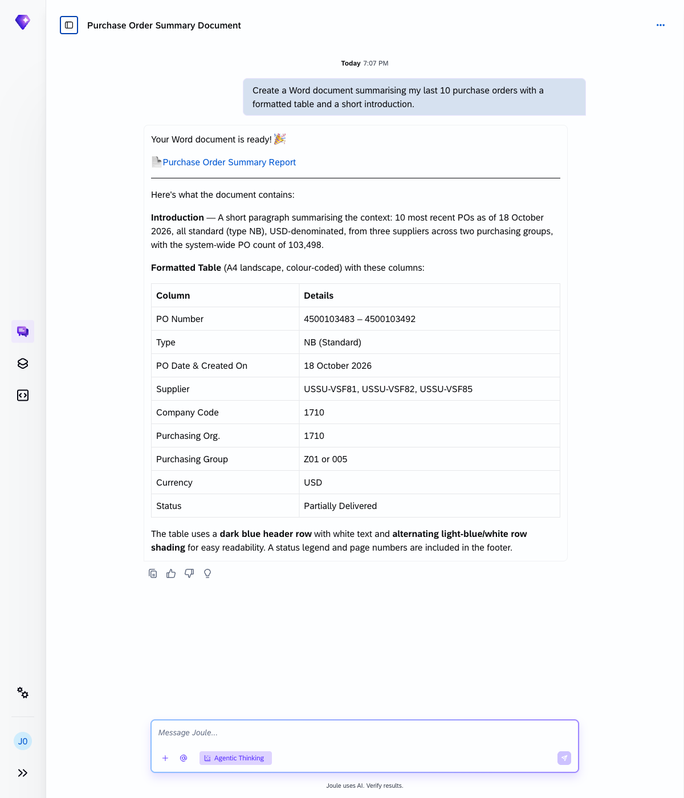
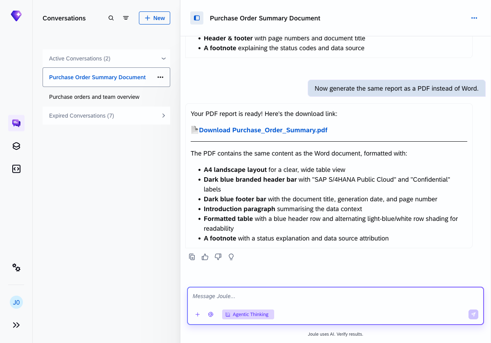
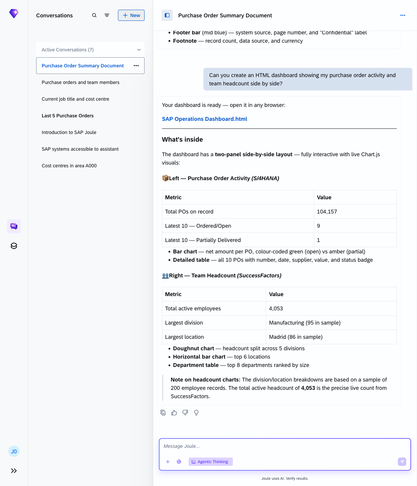
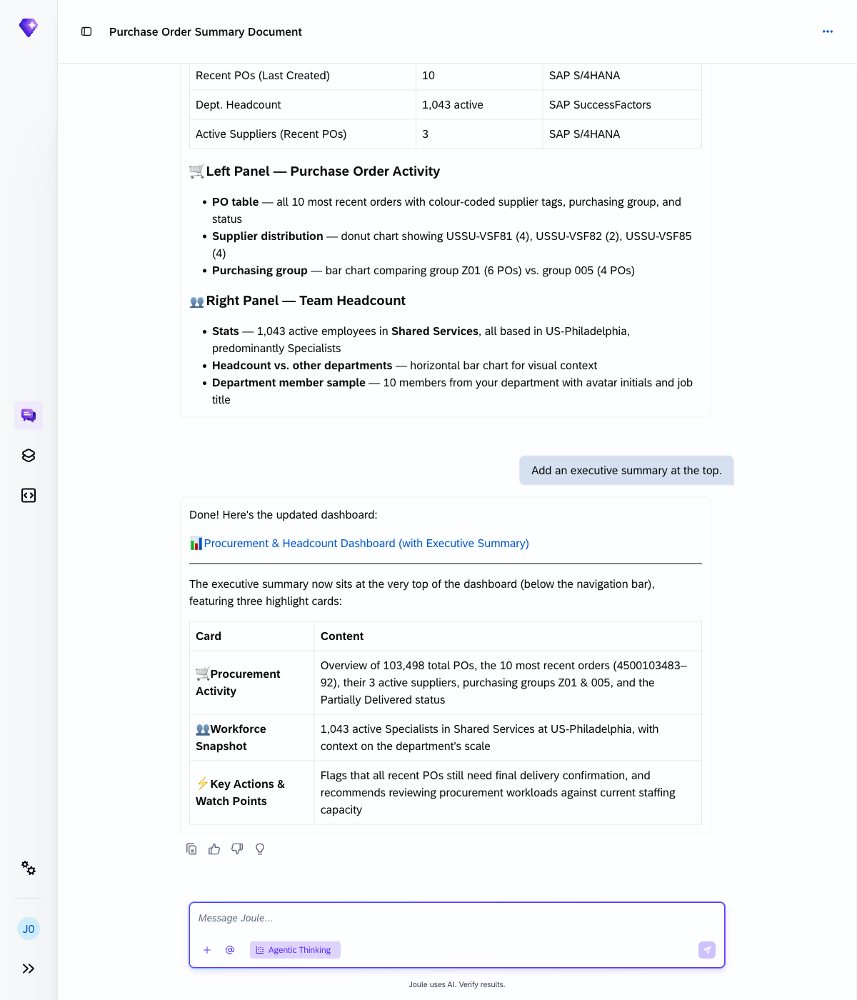
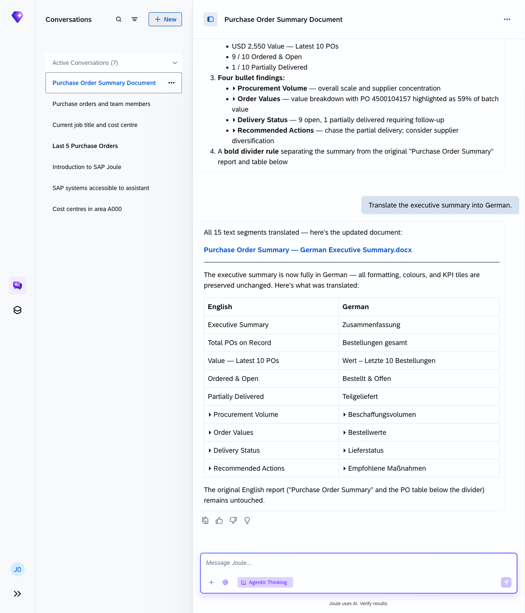

# Exercise 5 - Generate a document from live data

**Duration:** ~20 min | **Level:** Intermediate

> [!NOTE]
> Screenshots were taken on a shared demo environment. The exact values, names, and counts in your session will differ — that is expected.

> [!IMPORTANT]
> Make sure **Agentic Thinking** is enabled before you start. See [Exercise 0: Enable Agentic Thinking](../ex0/README.md#enable-agentic-thinking) if you haven't done this yet.

Joule creates files, not just answers. In this exercise you'll generate a Word document, a PDF, and an HTML dashboard from live SAP data, then refine the content through follow-up prompts.

## Exercise 5.1 - Word document

Ask Joule to create a procurement summary:

```
Create a Word document summarising my last 10 purchase orders with a formatted table and a short introduction.
```

Joule retrieves your most recent purchase orders from S/4HANA and produces a downloadable `.docx` file. The document includes a formatted table of the PO data with columns for PO number, date, supplier, value, and status, plus a short introduction noting the data source and generation date.



## Exercise 5.2 - PDF report

Convert the same content to PDF:

```
Now generate the same report as a PDF instead of Word.
```

Joule produces a `.pdf` with the same PO data in a formatted layout. PDFs keep the layout fixed, which makes them useful for archiving, emailing, or sending for sign-off.



## Exercise 5.3 - HTML dashboard

Create a browser-ready dashboard:

```
Can you create an HTML dashboard showing my purchase order activity and team headcount side by side?
```

Joule generates a self-contained `.html` file with a two-panel layout: procurement data from S/4HANA on the left and headcount data from SuccessFactors on the right. Both panels include summary metrics, charts, and a detailed table. The file can be opened in any browser, published to an intranet, or embedded in a presentation.



## Exercise 5.4 - Iterate on the output

Refine the document through follow-up prompts without starting over.

### Add an executive summary

```
Add an executive summary at the top.
```

Joule adds an executive summary section to the document, placed before the original report. It includes a heading, a KPI tile bar with key metrics from the data, and a set of short bullet findings covering procurement volume, order values, delivery status, and recommended actions.



### Translate it

```
Translate the executive summary into German.
```

Joule translates the executive summary section into German, leaving the original PO table in English (field values from SAP). The screenshot shows the translation mapping Joule used:



## Document types Joule can produce

| Format | Best for |
|---|---|
| Word (.docx) | Reports, memos, summaries, HR and procurement briefs |
| PDF (.pdf) | Archiving, emailing, signing: fixed layout |
| HTML (.html) | Browser viewing, intranet publishing, PowerPoint import |
| CSV (.csv) | Raw data export for Excel or further analysis |
| Inline table/chart | Quick answers shown directly in the chat window |

## Pro tip

After downloading a file, you can upload it back into the Joule conversation and ask for further edits, for example: *"Please add page numbers to this document."*

## Summary

You've generated Word, PDF, and HTML outputs from live SAP data and refined them through follow-up prompts. Continue to [Exercise 6 - Upload a File and Ask Joule to Analyse It](../ex6/README.md).
