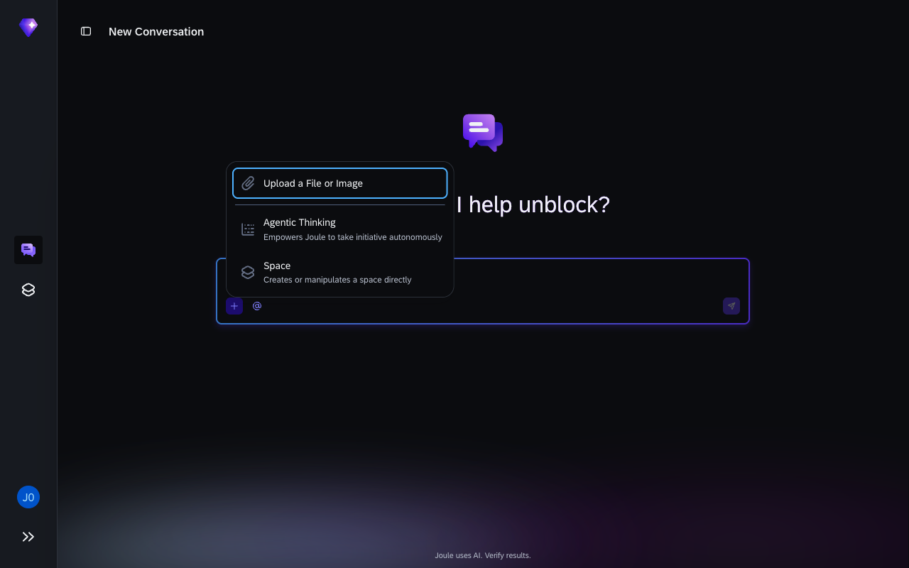
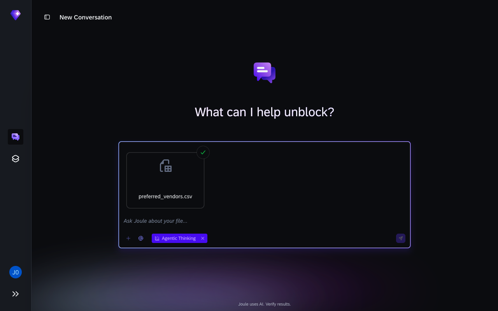
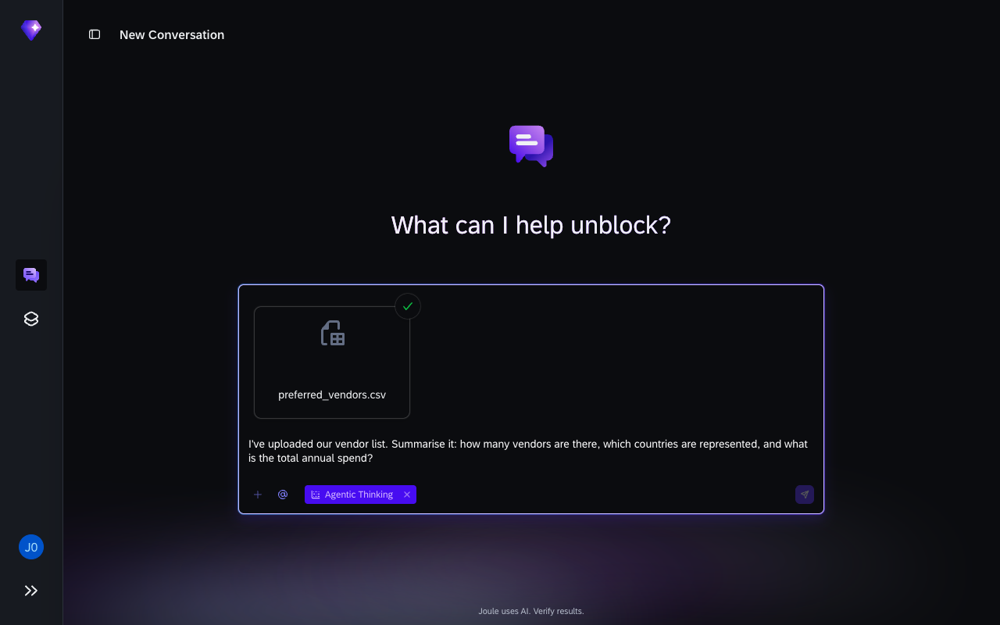
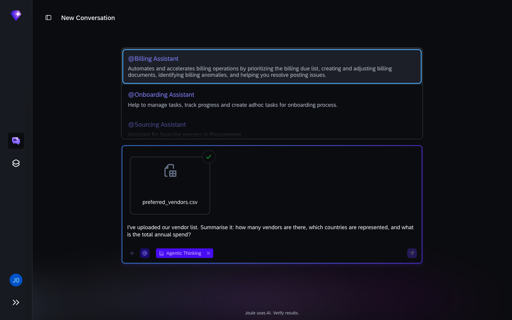
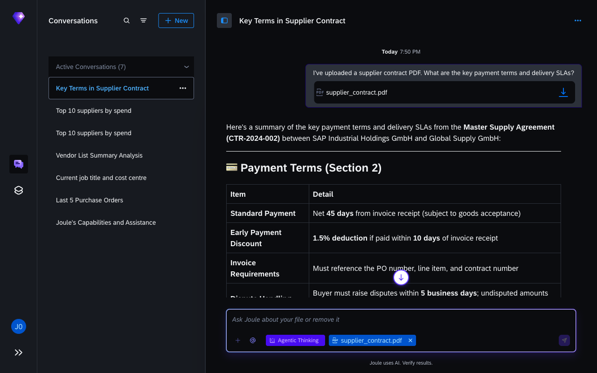
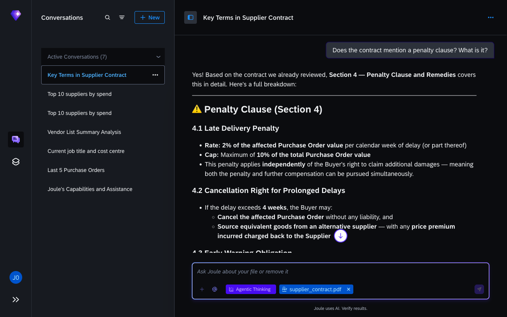
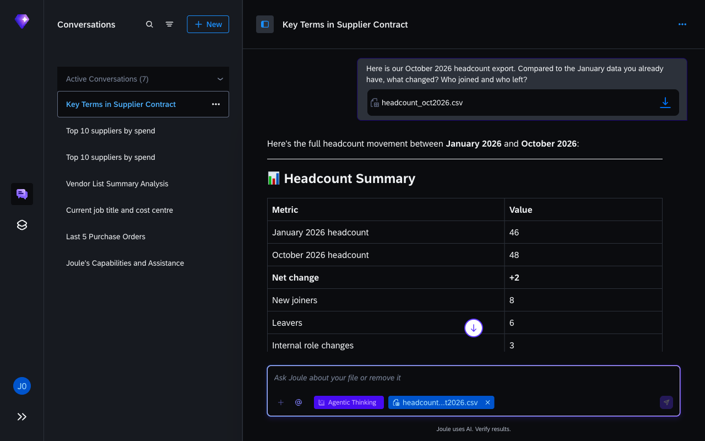
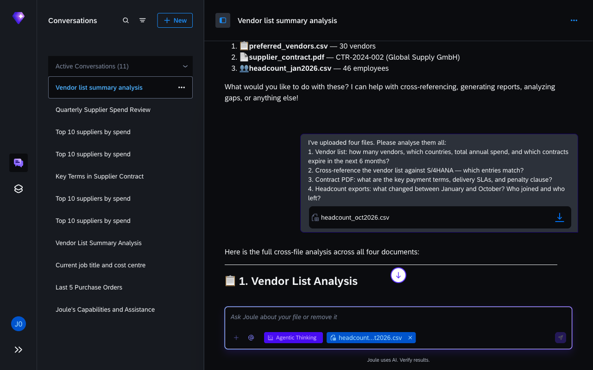

# Exercise 6 - Upload a file and ask Joule to analyse it

**Duration:** ~20 min | **Level:** Intermediate

> [!TIP]
> **Goal:** You've analysed uploaded files (a spreadsheet, a PDF contract, and two data exports) and combined them with live S/4HANA supplier data in a single conversation.
>
> If you want to try it yourself first, open a new Joule conversation and see how far you get. The step-by-step guide below is there when you need it.

> [!NOTE]
> Screenshots were taken on a shared demo environment. The exact values, names, and counts in your session will differ — that is expected.

> [!NOTE]
> **Instructor note:** This exercise uses four sample files included in this repository: `preferred_vendors.csv`, `supplier_contract.pdf` (a supplier contract), `headcount_jan2026.csv`, and `headcount_oct2026.csv`. All four files are in the `exercises/ex6/` folder.

> [!IMPORTANT]
> Make sure **Agentic Thinking** is enabled before you start. File upload only appears in the `+` menu when Agentic Thinking is active.

Joule isn't limited to SAP system data. You can upload your own files and ask it to interpret, summarise, cross-reference, or compare them against live SAP data.

**Supported formats:** Excel (.xlsx / .xls / .csv), PDF (.pdf), Word (.docx), and plain text. You can upload more than one file in the same conversation.

## How to upload a file

Open a new conversation and enable Agentic Thinking via the `+` button. Then click `+` again: you'll see **Upload a File or Image** at the top of the menu. Click it to open the file picker, then select your file.


After enabling Agentic Thinking, the chip appears in the input bar:


Click `+` again to reveal the upload option:



After selecting a file, it appears as a card above the text box; you can then type your question and send:



With the file attached, type your question and send:



You can also drag and drop a file directly onto the chat input area.

The `@` button (bottom-left of the input) opens a list of specialised assistants. You can activate one to focus Joule on that domain.



## Exercise 6.1 - Upload a vendor list

Upload `preferred_vendors.csv` via `+` → **Upload a File or Image**, then ask:

```
I've uploaded our vendor list. Summarise it: how many vendors are there, which countries are represented, and what is the total annual spend?
```

Joule reads the file and returns a breakdown of vendor count by country and a spend total. Follow up with a contract expiry check:

```
Which vendors have contracts expiring in the next 6 months? List their names, contract end dates, and annual spend.
```

Then cross-reference the uploaded list against live S/4HANA data:

```
Pull the supplier list from S/4HANA. Which entries match our uploaded vendor list?
```

Joule queries the S/4HANA Business Partner master to retrieve the supplier list and cross-references it against the uploaded CSV. Where commercial names in the file don't match legal entity names in S/4HANA, Joule flags the discrepancies and suggests next steps: search by SAP Vendor Number, filter by country, or onboard missing vendors directly.

> [!NOTE]
> The supplier cross-reference uses the S/4HANA Business Partner master data API. In some workshop environments this API may not be available. If Joule reports it cannot retrieve the supplier list, that is expected — the other sub-exercises will still work. Ask your instructor if you're unsure.

## Exercise 6.2 - Upload a PDF contract

Upload `supplier_contract.pdf`, then extract key terms:

```
I've uploaded a supplier contract PDF. What are the key payment terms and delivery SLAs?
```

Joule reads the PDF and returns a structured breakdown of the payment terms and delivery SLAs found in the document — including standard payment windows, early payment discounts, delivery lead times, and any special requirements.



Follow up with a specific question:

```
Does the contract mention a penalty clause? What is it?
```

Joule identifies the penalty clause section and explains the delay penalty structure, cancellation rights, and any early warning obligations defined in the contract.



## Exercise 6.3 - Compare two files

Upload the two headcount CSV exports in the same conversation. The app accepts one file per message, so upload `headcount_jan2026.csv` first with a short note, then attach `headcount_oct2026.csv` in a follow-up message and ask:

```
Here are two headcount exports from January and October. What changed? Who joined and who left?
```

Joule reads both files from the conversation context and produces a full diff: a summary table with total headcount change, joiners, leavers, and promotions, followed by detailed lists for each category with names, departments, and roles.



## One-shot: all three sub-exercises in a single run

The three sub-exercises above each use a separate file. You can run them all in one conversation by uploading each file in sequence and ending with a single compound prompt.

1. Open a new conversation with Agentic Thinking enabled.
2. Upload `preferred_vendors.csv` — type `First file: our vendor list.` and send.
3. Upload `supplier_contract.pdf` — type `Second file: a supplier contract.` and send.
4. Upload `headcount_jan2026.csv` — type `Third file: January 2026 headcount.` and send.
5. Upload `headcount_oct2026.csv`, then send this compound prompt:

```
I've uploaded four files. Please analyse them all:
1. Vendor list: how many vendors, which countries, total annual spend, and which contracts expire in the next 6 months?
2. Cross-reference the vendor list against S/4HANA — which entries match?
3. Contract PDF: what are the key payment terms, delivery SLAs, and penalty clause?
4. Headcount exports: what changed between January and October? Who joined and who left?
```

> [!NOTE]
> Question 2 (S/4HANA cross-reference) uses the Business Partner master data API. In some workshop environments this API may not be available — if so, Joule will note the gap and continue with the other three analyses. See the note in Exercise 6.1 above.

Joule reads all four files from the conversation context and returns analyses for all four questions in a single response. Questions 1, 3, and 4 draw entirely from the uploaded files and will always return results.



**Compare with the guided approach:** The sub-exercises above let you inspect each result before moving on. The one-shot version produces all four analyses in one pass — useful for a quick overview, less useful when you want to verify each step.

## What Joule does with an uploaded file

When you attach a file, Joule reads its content and adds it to the current conversation context. You can then ask questions about it, combine it with live SAP data, or use it as input for a generated document, all in the same conversation thread.

## Summary

You've used Joule to analyse a spreadsheet, extract terms from a PDF contract, and compare two data exports, combining uploaded files with live S/4HANA supplier data in a single step. Continue to [Exercise 7 - Chaining Multiple Capabilities](../ex7/README.md).
