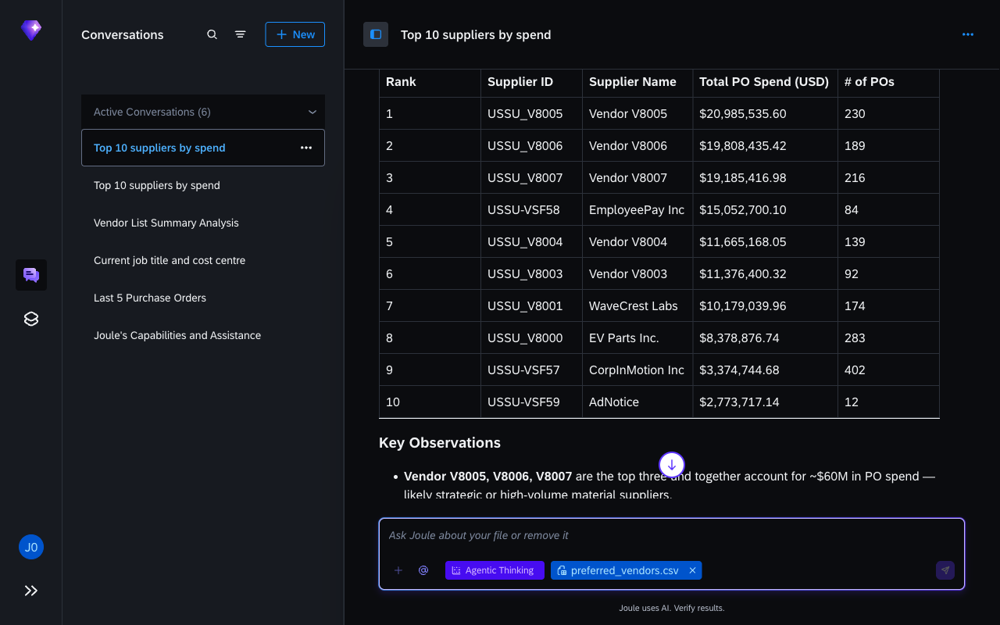
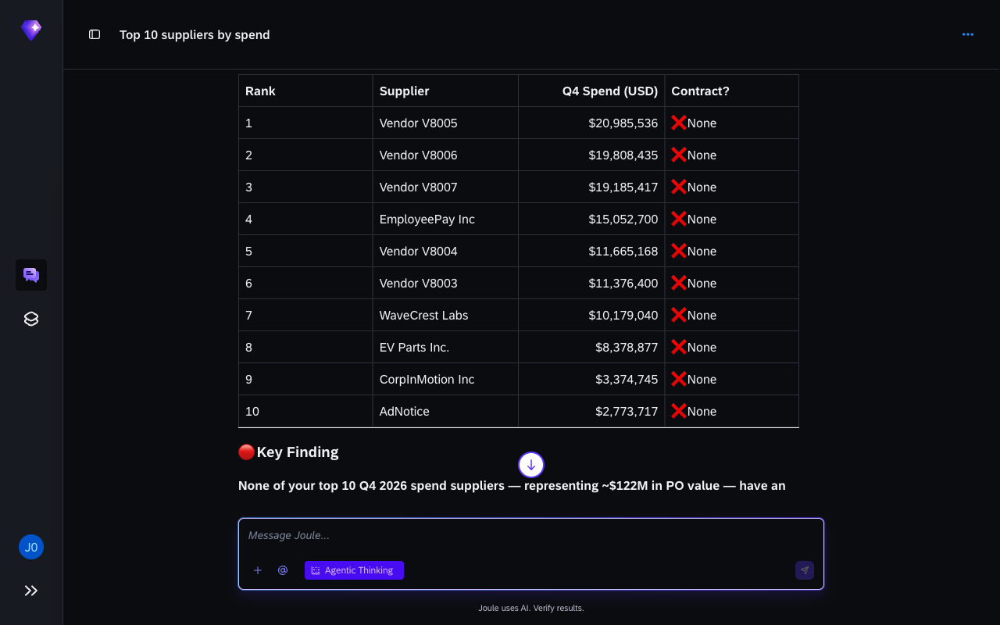
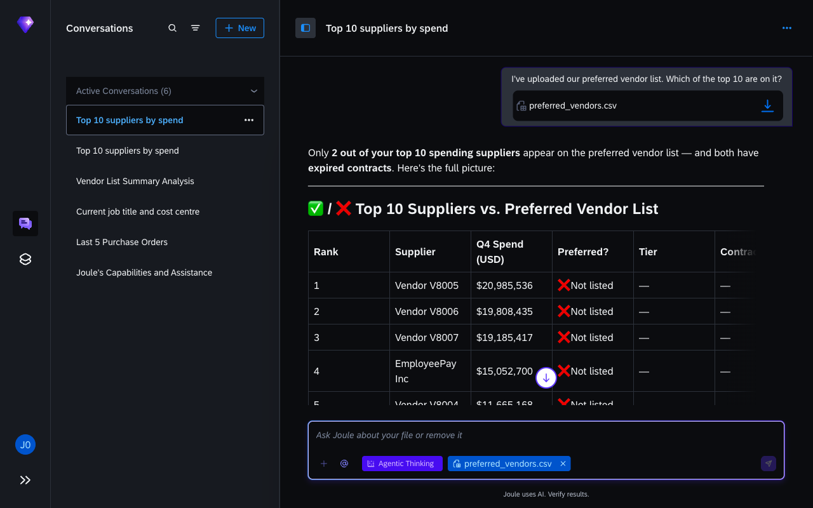
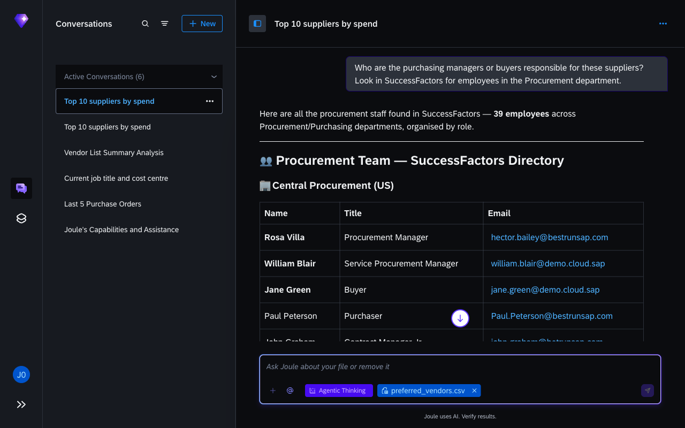
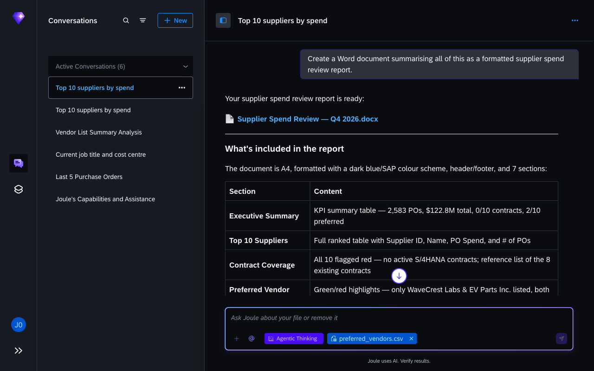

# Exercise 7 - Chaining multiple capabilities

**Duration:** ~30 min | **Level:** Advanced

> [!TIP]
> **Goal:** You've run a complete quarterly procurement review across two SAP systems, an uploaded file, and a generated Word document — all through conversation.
>
> If you want to try it yourself first, open a new Joule conversation and see how far you get. The step-by-step guide below is there when you need it.

> [!NOTE]
> Screenshots were taken on a shared demo environment. The exact values, names, and counts in your session will differ — that is expected.

> [!IMPORTANT]
> Make sure **Agentic Thinking** is enabled before you start. See [Exercise 0: Enable Agentic Thinking](../ex0/README.md#enable-agentic-thinking).
>
> **Skills required:** `SAP S/4HANA Cloud Public Edition`, `SAP Ariba Buying`, `SAP Ariba Sourcing`, `SAP SuccessFactors HCM`, `Word Documents`. Enable all five in Explore Skills before starting.

> [!NOTE]
> The `SAP Ariba Buying` and `SAP Ariba Sourcing` skills require a live Ariba backend. In some workshop tenants, Ariba connectivity may not be available. If Step 2 only returns S/4HANA results, that is expected — Steps 1, 3, 4, and 5 will still work. Ask your instructor if you're unsure.

This exercise chains everything together: live S/4HANA data, contract coverage, a file cross-reference, SAP SuccessFactors HCM data, and a generated Word document, all in one conversation. It mirrors a real quarterly procurement review.

Work through the five prompts in order, in the same Joule conversation. Don't start a new chat between steps — Joule carries context forward so each step builds on the last.

## Step 1 - Pull top suppliers from S/4HANA

```
Show me the top 10 suppliers by PO spend this quarter from S/4HANA.
```

Joule queries S/4HANA purchase orders for the current quarter and returns a ranked table showing each supplier's name, ID, number of POs, and total net spend. The table also notes what percentage of total quarter spend the top 10 represent.



## Step 2 - Check contracts for each supplier

```
Show me all active purchase contracts in S/4HANA. Which of our top 10 suppliers are covered?
```

Joule fetches the full list of active purchase contracts from S/4HANA in a single query, then cross-references that list against the top 10 suppliers from Step 1. If none of the high-spend suppliers appear in the contract list, Joule flags this as a risk finding and summarises how much spend is going through without contract coverage.



## Step 3 - Cross-reference with the preferred vendor list

Upload `preferred_vendors.csv` from the `exercises/ex6/` folder using `+` → **Upload a File or Image**, then ask:

```
I've uploaded our preferred vendor list. Which of the top 10 are on it?
```

Joule checks both by SAP Vendor ID and by company name, including partial matching, and adds a preferred vendor column to the table. It then combines the contract and preferred vendor findings into a consolidated risk view: which suppliers are high-spend but both off-contract and off the preferred list.



## Step 4 - Find the procurement team in SuccessFactors

```
Who are the purchasing managers or buyers responsible for these suppliers? Look in SuccessFactors for employees in the Procurement department.
```

Joule queries SAP SuccessFactors HCM and returns a procurement team directory organised by role level, including names, titles, departments, and email addresses. SAP SuccessFactors HCM holds the team structure but not a supplier-to-buyer mapping, so Joule returns the full procurement directory and highlights the roles most relevant to the contract gap identified in Step 2.



## Step 5 - Generate the review document

```
Create a Word document summarising all of this as a formatted supplier spend review report.
```

Joule generates a downloadable `.docx` file containing a multi-section supplier spend review report: an executive summary with key findings, the ranked supplier table, contract coverage, preferred vendor alignment, the procurement team directory, prioritised recommendations, and a data sources audit trail.

Click the document link in Joule's response to download the file.



## What to notice

- Joule carries context from step to step — you never need to re-specify the supplier list or company code.
- Each step adds a new data layer: S/4HANA, contract records, an uploaded file, SAP SuccessFactors HCM, and a generated document.
- The Word document draws on everything in the conversation, not just the last prompt.
- The combined risk pattern emerged from combining three separate data sources. No single step would have revealed it on its own.

## One-shot: the full review in a single prompt

Upload `preferred_vendors.csv` from the `exercises/ex6/` folder using `+` → **Upload a File or Image**, then send this compound prompt:

```
I've uploaded our preferred vendor list. Please do all of this in one go:
1. Pull the top 10 suppliers by PO spend this quarter from S/4HANA.
2. Check which of them have active purchase contracts.
3. Cross-reference the top 10 against the uploaded preferred vendor list.
4. Look in SuccessFactors for the procurement team responsible for these suppliers.
5. Create a Word document summarising all findings as a quarterly supplier spend review.
```

Joule runs all five steps autonomously: it pulls the top-10 supplier spend, checks contract coverage, cross-references the uploaded vendor list, looks up the procurement team in SuccessFactors, and generates the Word document — all in one response.

**Compare with the guided approach:** The step-by-step version spread the same work across five prompts, letting you verify each data layer before moving to the next. The one-shot version produces the same output in one go but gives you less visibility into how Joule assembled the result.

## Summary

You've run a full quarterly procurement review across two SAP systems, an uploaded file, and a generated report, entirely through conversation. Continue to [Exercise 8 - Web-Augmented Intelligence: Build a Live Dashboard](../ex8/README.md).
