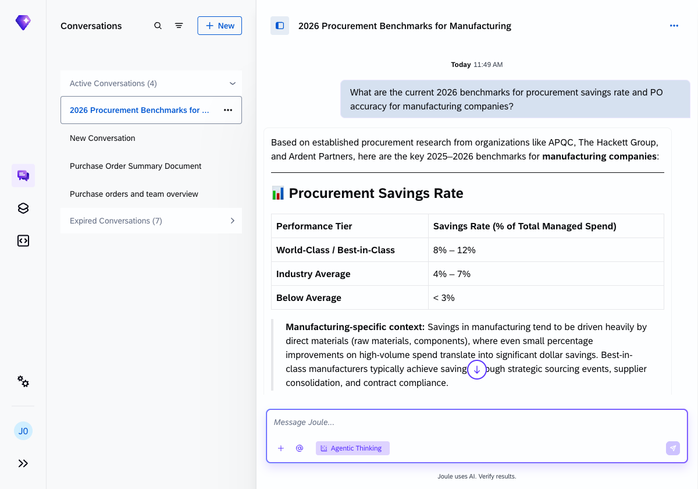
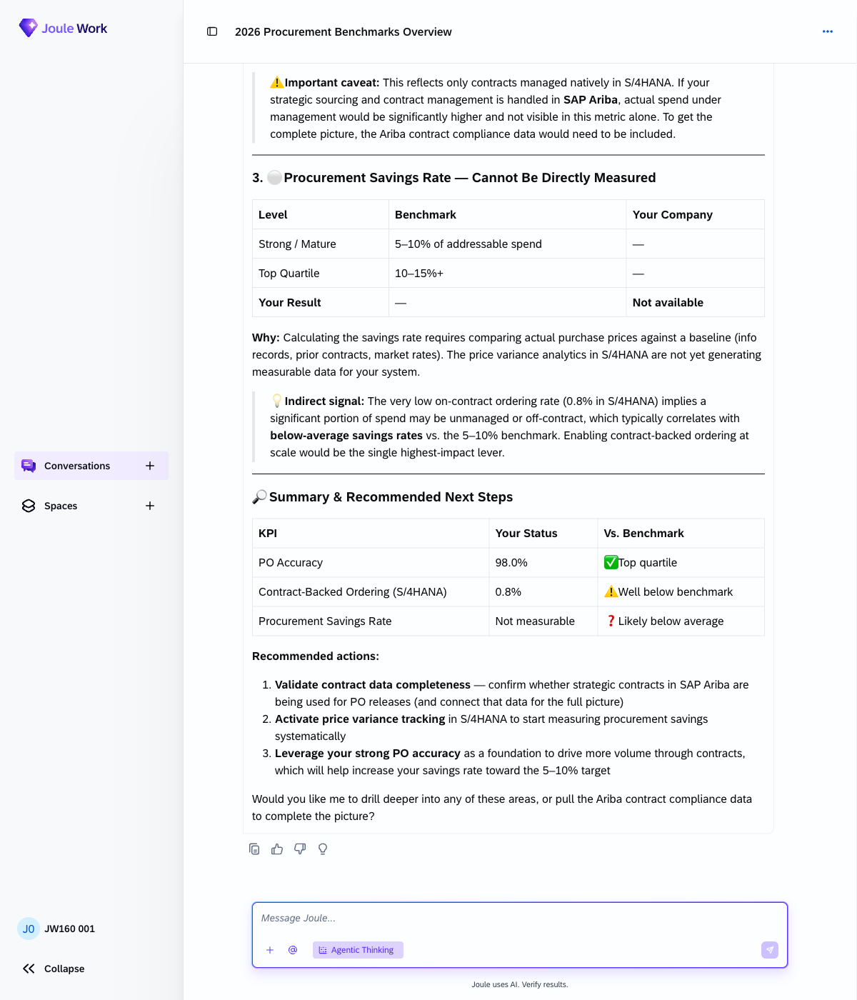
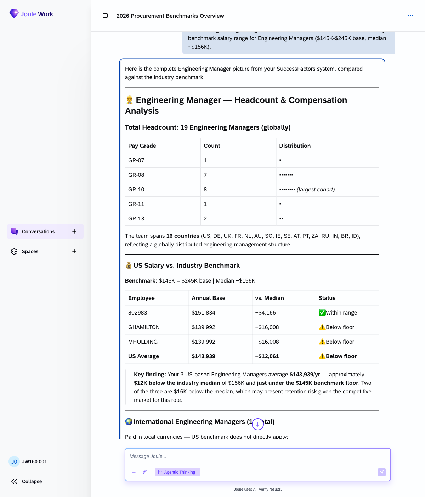
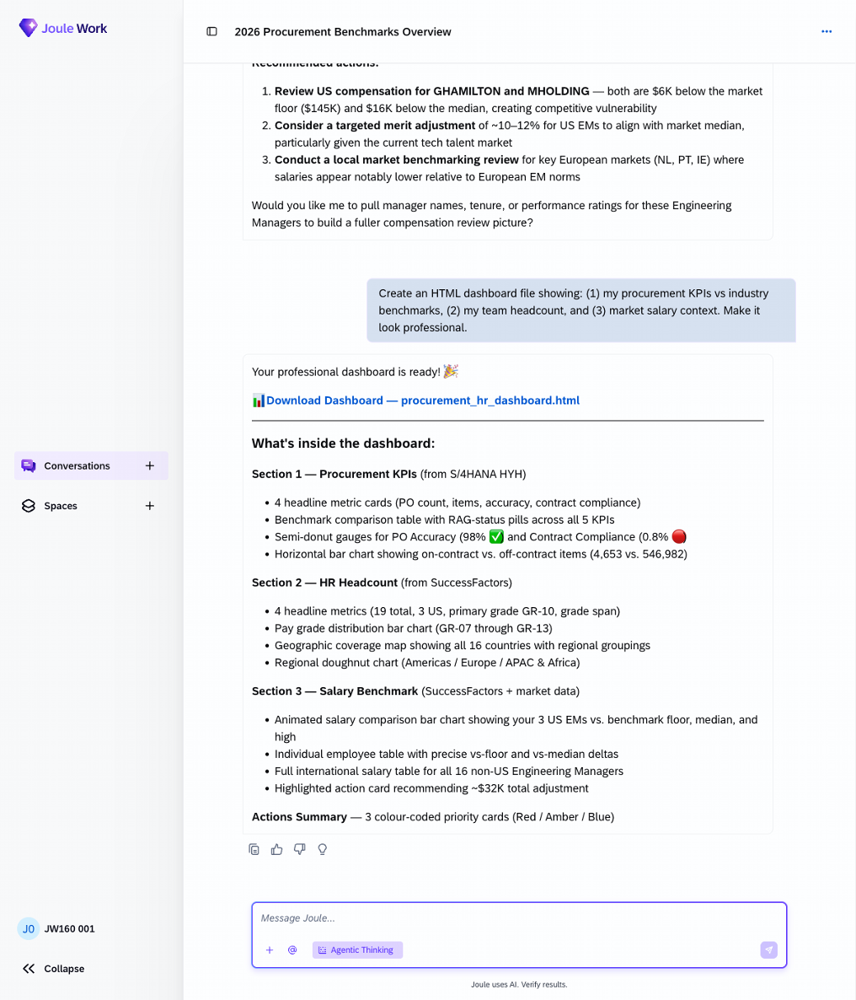
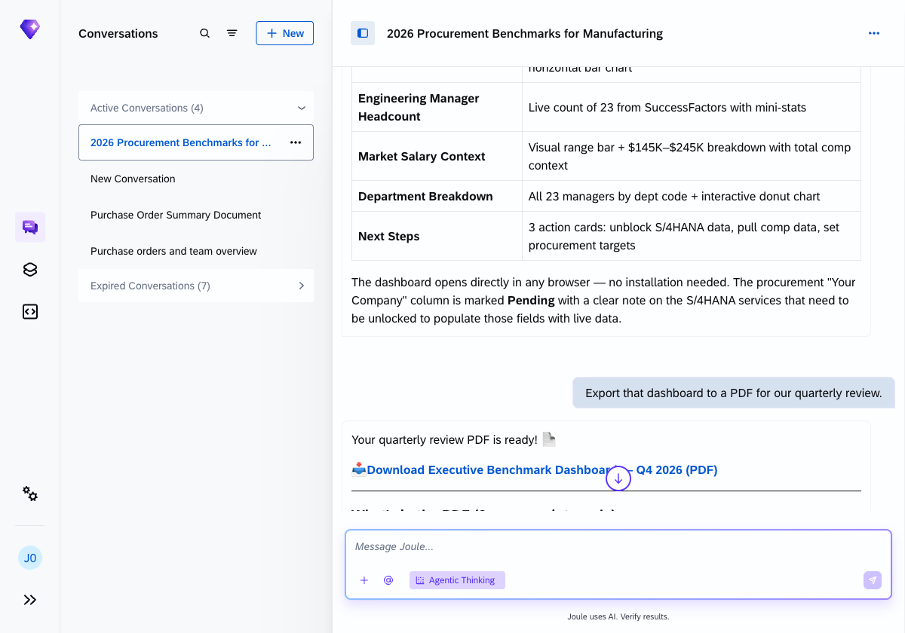

# Exercise 8 - Web-augmented intelligence: build a live dashboard

**Duration:** ~25 min | **Level:** Advanced

> [!TIP]
> **Goal:** You've built an HTML dashboard combining live SAP data with web-sourced industry benchmarks, then exported it as a PDF.
>
> If you want to try it yourself first, open a new Joule conversation and see how far you get. The step-by-step guide below is there when you need it.

> [!NOTE]
> Screenshots were taken on a shared demo environment. The exact values, names, and counts in your session will differ — that is expected.

> [!IMPORTANT]
> Make sure **Agentic Thinking** is enabled before you start. See [Exercise 0: Enable Agentic Thinking](../ex0/README.md#enable-agentic-thinking) if you haven't done this yet.

Joule can reach beyond your SAP landscape. In this exercise you ask it to pull industry benchmark data from the web and combine it with live SAP data to build an intelligence dashboard, the kind of view that would normally take a team hours to assemble.

A working example of the dashboard this exercise produces is in `Joule_Dashboard_Exercise8_Example.html` (shared by your instructor). Use it as a reference for what the final output can look like.

## Exercise 8.1 - Get industry benchmarks from the web

Ask Joule to search for current procurement benchmarks:

```
What are the current 2026 benchmarks for procurement savings rate and PO accuracy for manufacturing companies?
```

Joule draws on established procurement research (JAGGAER, APQC, McKinsey, Varisource) and returns tiered benchmark tables for manufacturing companies, covering Procurement Savings Rate and PO Accuracy at each performance level from under-performing through world-class.



## Exercise 8.2 - Compare to your own SAP data

Now layer in your live data:

```
Now compare our company's procurement activity from S/4HANA to those benchmarks.
```

Joule queries S/4HANA and returns live figures for procurement KPIs, comparing each against the benchmarks from Step 1. The comparison shows where your company is in each benchmark tier, flags any gaps, and includes recommendations on which levers to prioritise.

> [!NOTE]
> Some KPIs (such as procurement savings rate) may not be measurable if price variance analytics are not configured in your S/4HANA system. Joule will flag any gaps and use available signals as a proxy.



## Exercise 8.3 - Add HR context

Bring in SuccessFactors data and a market salary range:

```
Add our Engineering Manager headcount from SuccessFactors and the industry benchmark salary range for Engineering Managers ($145K-$245K base, median ~$156K).
```

Joule queries SuccessFactors and returns the Engineering Manager headcount globally, broken down by pay grade and country. It then compares US-based managers against the provided benchmark range, calculating each employee's position relative to the floor and median, and highlights any compensation gaps that may present retention risk.

> [!NOTE]
> The benchmark applies directly only to US-based employees. International managers are paid in local currencies, so the US benchmark doesn't apply to them directly.



## Exercise 8.4 - Generate the HTML dashboard

Ask Joule to pull everything together into a visual file:

```
Create an HTML dashboard file showing: (1) my procurement KPIs vs industry benchmarks, (2) my team headcount, and (3) market salary context. Make it look professional.
```

Joule generates a self-contained `.html` file with three sections plus an actions summary: Procurement KPIs from S/4HANA with benchmark comparison gauges and charts, HR headcount from SuccessFactors with pay grade and geographic distribution, and salary benchmark analysis with individual employee positioning against the market range.

Open the file in any browser — no server required.



## Exercise 8.5 - Export to PDF

Convert the dashboard for a quarterly review pack:

```
Export that dashboard to a PDF for our quarterly review.
```

Joule generates a print-ready PDF with the same three sections, formatted for a professional procurement review. Each page carries a header with title and section context, plus a footer with data source attribution and a confidentiality label.



## Summary

You built a live intelligence dashboard by combining SAP system data with real-world market benchmarks, entirely through conversation. Continue to [Exercise 9 - Knowledge Graph: Explore Hidden Data Relationships](../ex9/README.md).
