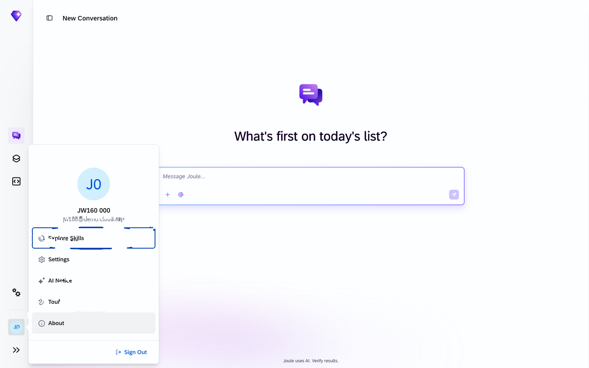
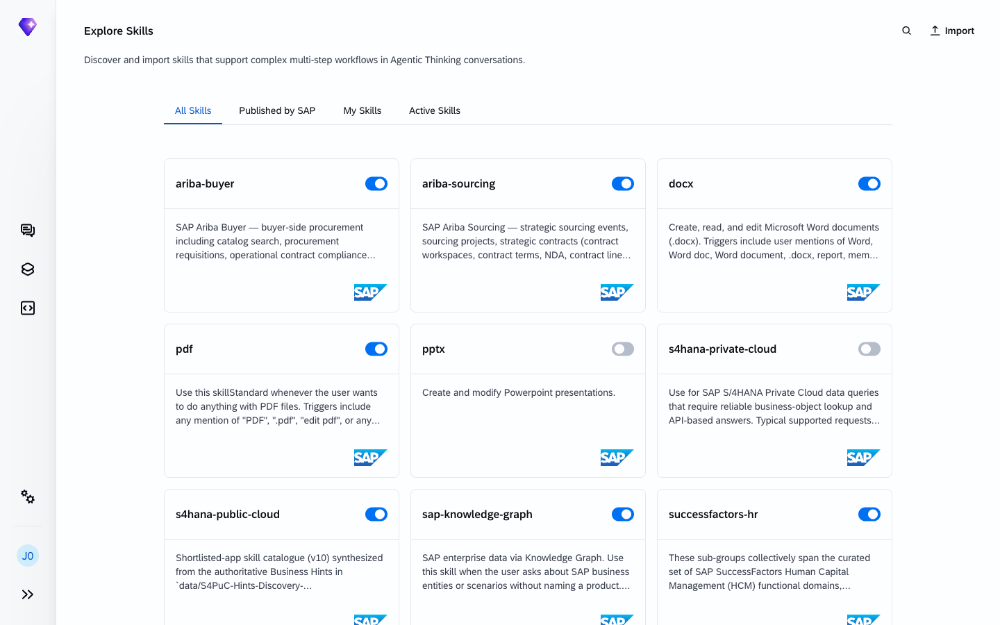
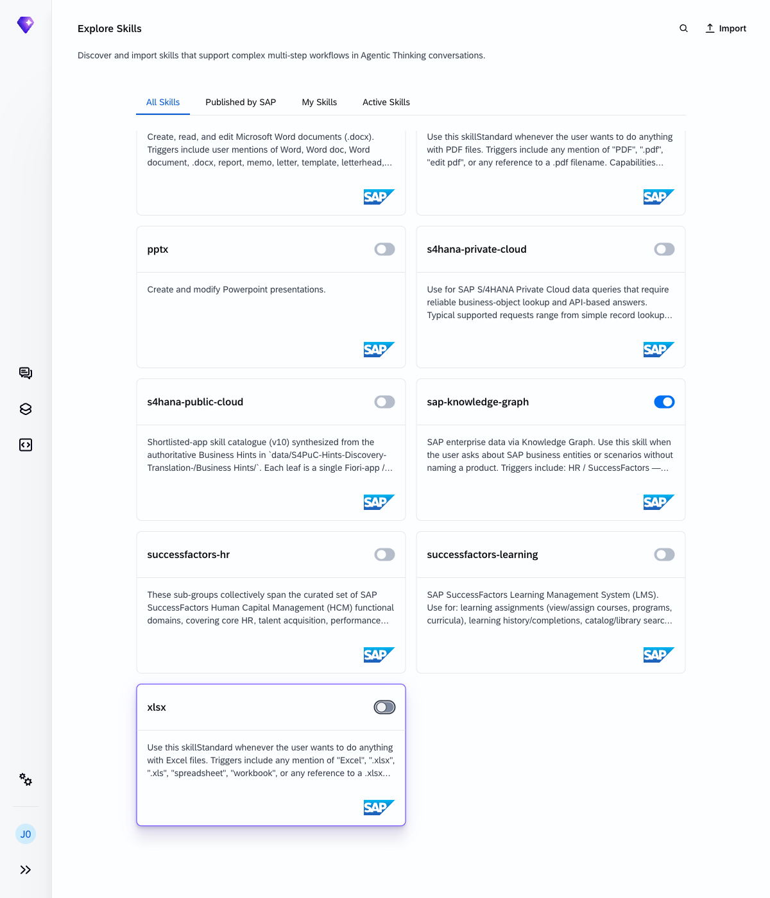
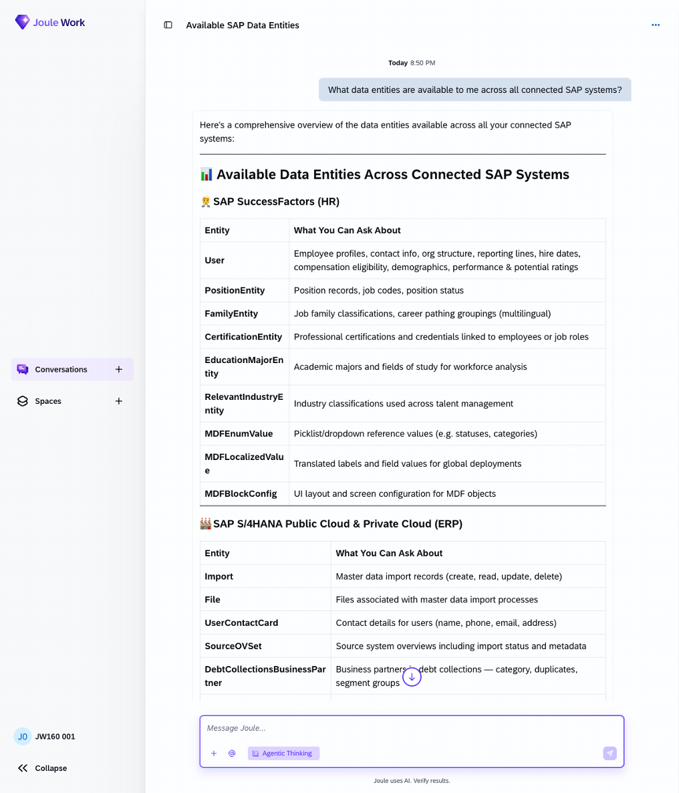
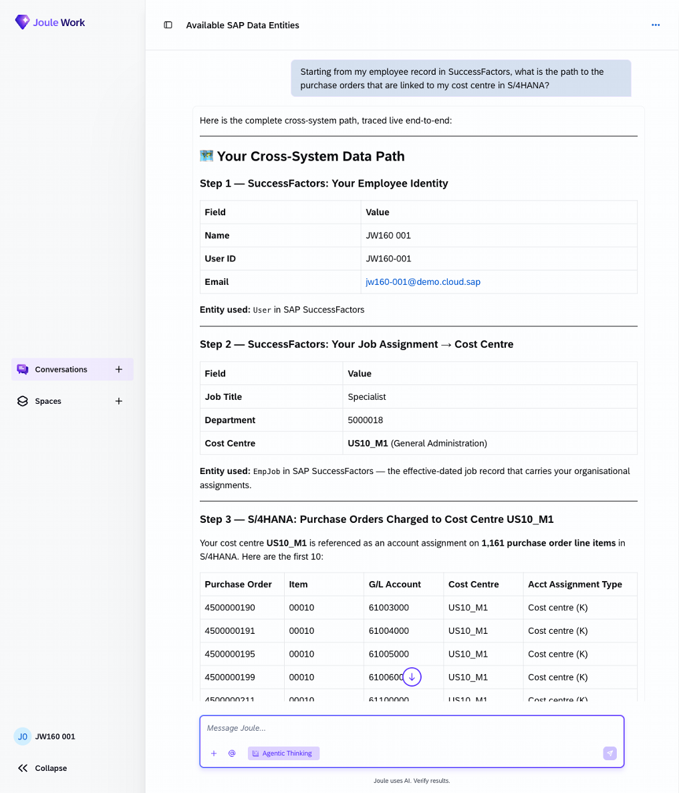
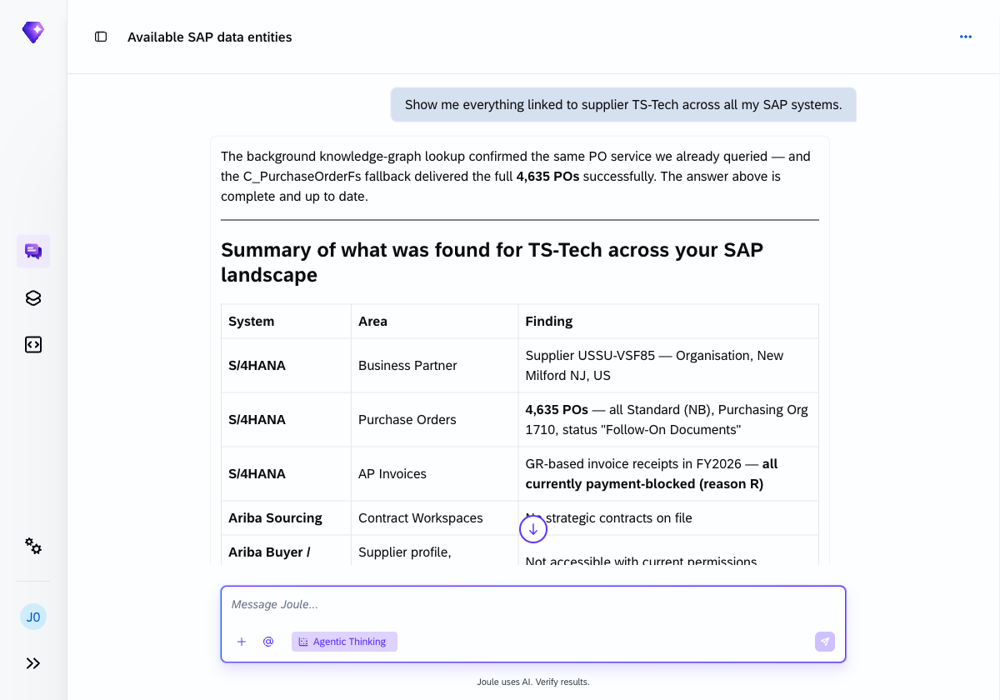
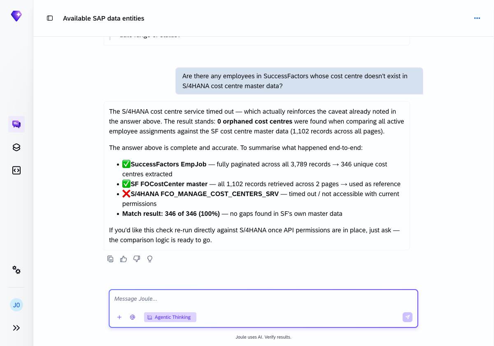
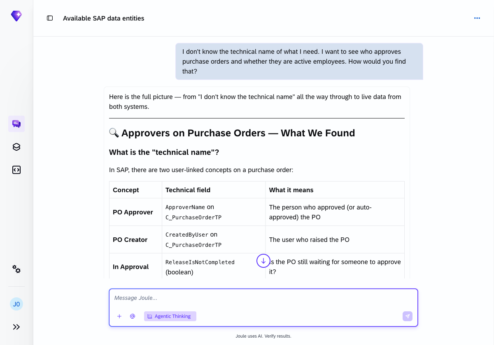

# Exercise 9 - Knowledge Graph: explore hidden data relationships

**Duration:** ~20 min | **Level:** Advanced

> **Prerequisite:** Make sure **Agentic Thinking** is enabled before you start. See [Exercise 0: Enable Agentic Thinking](../ex0/README.md#enable-agentic-thinking) if you haven't done this yet.

> **For this exercise only — disable all skills except `sap-knowledge-graph`.**
>
> This lets you see what the Knowledge Graph skill can do on its own, without any of the individual system skills (S/4HANA, SuccessFactors, etc.) active. The queries will still return live data — the Knowledge Graph connects to the underlying systems directly.
>
> **Step 1:** Click your user avatar in the bottom-left corner of Joule, then select **Explore Skills**.
>
> 
>
> **Step 2:** The Explore Skills page shows all your active skills. You will disable every skill **except** `sap-knowledge-graph` — click the blue toggle on each card to turn it grey (off).
>
> 
>
> **Step 3:** When you are done, only `sap-knowledge-graph` should have a blue toggle. All other cards should be grey.
>
> 
>
> **Step 4:** Run the exercises below. When you finish Exercise 9, come back to Explore Skills and re-enable all the skills you turned off.

The SAP Knowledge Graph is a semantic layer that connects data entities across your SAP landscape. Joule uses it to discover relationships you didn't know existed and to answer questions that span multiple systems, without having to name which API to call.

Use this exercise when you don't know where the data lives. Describe what you want and Joule works out the path.

## Exercise 9.1 - Discover what's available

Start by asking what data entities exist across all connected systems:

```
What data entities are available to me across all connected SAP systems?
```

Joule returns a full catalogue of every entity type accessible in your landscape, grouped by system:

**SAP Ariba Buyer:** Catalog, Procurement Requisitions, Operational Contracts, Master Data (Platform)

**SAP Ariba Sourcing:** Sourcing Events (RFx events, bids, awards), Sourcing Projects, Strategic Contracts (contract workspaces, terms, NDA export), Supplier Management (questionnaires, certificates, workspaces)

**SAP S/4HANA Public Cloud:** 175+ ERP entities across 21 domains including Accounts Payable, Accounts Receivable, Asset Accounting, Cash & Treasury, Controlling, Finance/GL, Inventory Management, Logistics Execution, Manufacturing, Procurement & Sourcing, Production Planning, Project Management, Quality Management, Sales & Billing, Service, Warehouse Management

**SAP SuccessFactors HR:** 203 HR entities across Core HR, Position Management, Recruiting, Onboarding, Performance Management, 360 Reviews, Goal Management, OKR, Calibration, Compensation, Payroll, Time Management, Benefits, Global Assignments, Succession & Development, Job Profile Builder, Mentoring, Continuous Performance

**SAP SuccessFactors Learning (LMS):** Learning Assignments, Learning History, Curriculum & Compliance, Classes & Enrollment, Catalog, Skills & Capabilities, Team Learning, Suggestions, Tasks & Approvals, Ratings & Surveys, External Training



## Exercise 9.2 - Navigate a relationship path

Ask Joule to trace a live cross-system path starting from your own employee record:

```
Starting from my employee record in SuccessFactors, what is the path to the purchase orders that are linked to my cost centre in S/4HANA?
```

Joule executes a 3-hop traversal and returns actual live data at each step. The values below come from the instructor account (JW160-000); your result will show your own user ID and the cost centre assigned to your account.

Step 1: Your employee record (SuccessFactors)

| Field | Value |
|---|---|
| User ID | JW160-000 |
| Job Title | Specialist |
| Cost Centre | **US10_M1** |
| Cost Centre Name | General Administration |
| Department | 5000018 |

**Step 2: The link.** Your SuccessFactors job record holds a cost centre code (`US10_M1`). The same code is stamped on purchase order line items in S/4HANA as the account assignment (the accounting object that bears the spend).

**Step 3: Purchase orders in S/4HANA.** **1,144 PO line items** are assigned to cost centre US10_M1, all with account assignment category **K** (= Cost Centre).

The data path in summary:

```
SuccessFactors                           S/4HANA
──────────────────────────               ──────────────────────────────────────
EmpJob (userId = JW160-000)
  └─ costCenter = "US10_M1"  ──────►   C_PurOrdAcctAssignmentTP
                                           └─ CostCenter = "US10_M1"
                                               └─ PurchaseOrder (1,144 items)
```



## Exercise 9.3 - Cross-LOB discovery (no system specified)

Ask about a supplier without telling Joule which system to check:

```
Show me everything linked to supplier TS-Tech across all my SAP systems.
```

Joule searches across all connected systems and returns a consolidated summary:

| System | Area | Finding |
|---|---|---|
| S/4HANA | Business Partner | Supplier USSU-VSF85, Organisation, New Milford NJ, US |
| S/4HANA | Purchase Orders | **4,635 POs**, all Standard (NB), Purchasing Org 1710, status "Follow-On Documents" |
| S/4HANA | AP Invoices | GR-based invoice receipts in FY2026, **all currently payment-blocked (reason R)** |
| Ariba Sourcing | Contract Workspaces | No strategic contracts on file |
| Ariba Buyer / Sourcing | Supplier profile, operational contracts | Not accessible with current permissions |

The payment block on all AP invoices is notable: reason code "R" typically indicates a manual block set by AP staff.



## Exercise 9.4 - Surface anomalies

Ask Joule to find inconsistencies between the two systems:

```
Are there any employees in SuccessFactors whose cost centre doesn't exist in S/4HANA cost centre master data?
```

Joule performs a cross-system set comparison:

- **SuccessFactors EmpJob:** fully paginated across all 3,789 records → 346 unique cost centres extracted
- **SF FOCostCenter master:** all 1,102 records retrieved across 2 pages → used as reference
- **S/4HANA FCO_MANAGE_COST_CENTERS_SRV:** timed out / not accessible with current permissions
- Match result: 346 of 346 (100%), no gaps found within SF's own master data

The S/4HANA cost centre service was not available in this demo environment, so the comparison ran against the SuccessFactors cost centre master only. In a fully connected system, this query would perform the comparison directly against S/4HANA cost centre master data and flag any employee records pointing to a cost centre that doesn't exist in ERP.



## Exercise 9.5 - Navigate without knowing the technical names

This one requires no SAP knowledge at all:

```
I don't know the technical name of what I need. I want to see who approves purchase orders and whether they are active employees. How would you find that?
```

Joule uses the Knowledge Graph to identify the relevant entities and field names, then executes the query and explains the result:

**What the technical fields are:**

| Concept | Technical field | What it means |
|---|---|---|
| PO Approver | `ApproverName` on `C_PurchaseOrderTP` | The person who approved (or auto-approved) the PO |
| PO Creator | `CreatedByUser` on `C_PurchaseOrderTP` | The user who raised the PO |
| In Approval | `ReleaseIsNotCompleted` (boolean) | Is the PO still waiting for someone to approve it? |

**What was found in S/4HANA** (102,951 purchase orders accessible):

| Finding | Detail |
|---|---|
| POs awaiting approval right now | **0**: no PO is currently pending a human sign-off |
| Approver names in sampled POs | All show `"Approved automatically"` (the flexible workflow is configured to auto-approve) |
| PO creator in sample | `CB9980000052`, a system/service user, not a named individual |
| Flexible workflow active? | Yes: all POs carry the flexible workflow flag |

**The identity mapping challenge:** S/4HANA PO creator IDs (`CB9980000052`) are in a different namespace than SuccessFactors user IDs (`JW160-000`, `aacar`). To cross-check approvers against active employees, the path would be:

```
Step 1: S/4HANA
  C_PurchaseOrderTP → ApproverName / CreatedByUser
  → S/4HANA Business User → email address

Step 2: SuccessFactors
  User entity → filter by email → check status (active/inactive)

Step 3: Flag any approver/creator whose SF status ≠ active
```

In this environment, all POs are auto-approved by a system user, with no human names to cross-check. This is worth flagging to a procurement team: if the intent is that a human manually approves POs, the workflow configuration may need adjusting.



## When to use the Knowledge Graph

The Knowledge Graph is most useful when:

- You're not sure which system holds the data you need
- You want to discover relationships between entities you wouldn't normally connect
- You're looking for inconsistencies or gaps across systems
- You're exploring an unfamiliar part of your SAP landscape

## Summary

You used the SAP Knowledge Graph to discover data relationships, trace cross-system paths using live data, and surface anomalies, without specifying any APIs or system names. Continue to [Exercise 10 - Upload, Activate and Test a New Skill](../ex10/README.md).
